<div align="center">

# 纹脉华章

### 传统文化视觉智能创作与沉浸式文创应用平台

从五种传统视觉风格出发，将参考图与主题转为 AI 作品，再连接文化赏析、互动叙事、三维布展和文创预览。

[在线体验](https://3331083641-prog.github.io/wenmai-huazhang/#/) · [功能展示](#核心功能与真实界面) · [快速开始](#安装与运行) · [技术架构](#技术架构) · [项目源码](https://github.com/3331083641-prog/wenmai-huazhang)

</div>

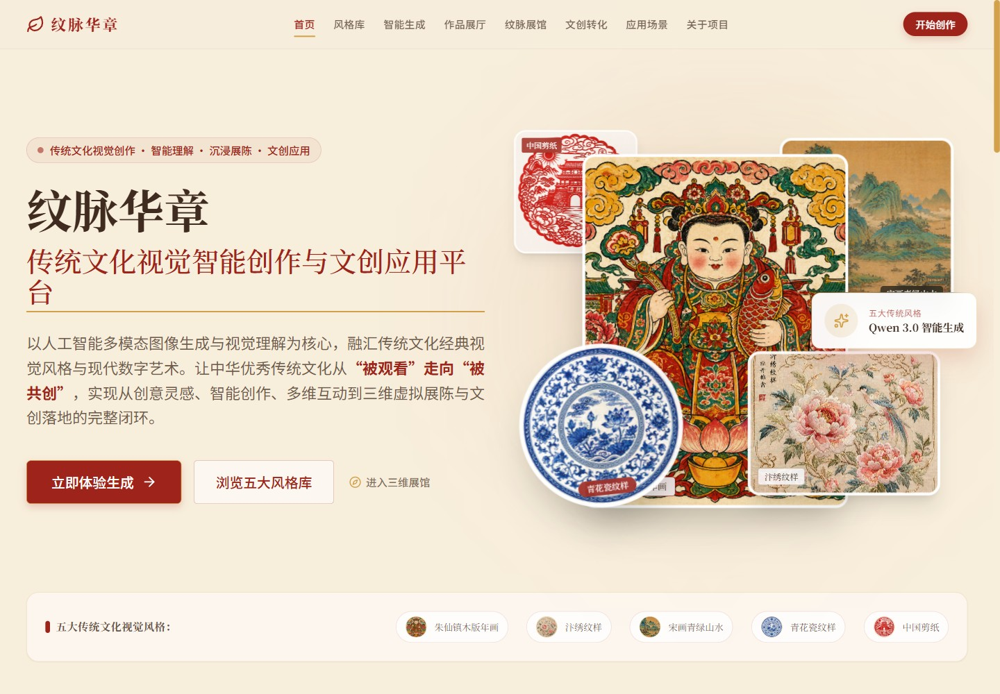

> 在线入口为静态演示，可浏览已保存作品、互动、经典展馆与文创模板。实时生图、自动保存和新作品互动构建需要在本机运行后端与模型；在线页面不提供作者的 API 密钥。

## 从文化风格到自己的展览

纹脉华章面向传统文化创作、美育研学与文创设计探索。用户选择视觉风格，输入主题或参考图，获得作品与文化说明，再以热点、章节、画境和虚拟展馆继续阅读、展示与应用。

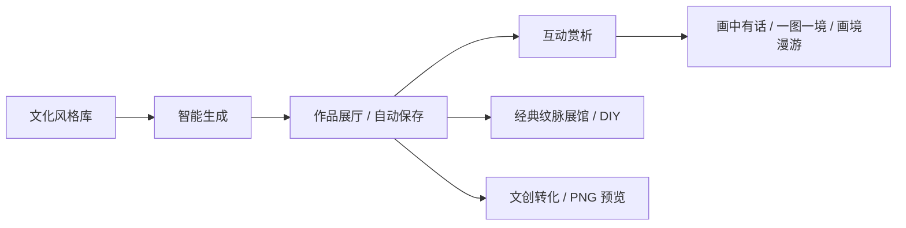

## 核心功能与真实界面

### 选择风格，控制创作

五种正式风格为 **朱仙镇木版年画、汴绣纹样、宋画青绿山水、青花瓷纹样、中国剪纸**。创作台支持文本、参考图、主体、风格提示强度、负向提示、构图与用途控制。

| 文化风格库 | 智能生成工作台 |
|:---:|:---:|
| [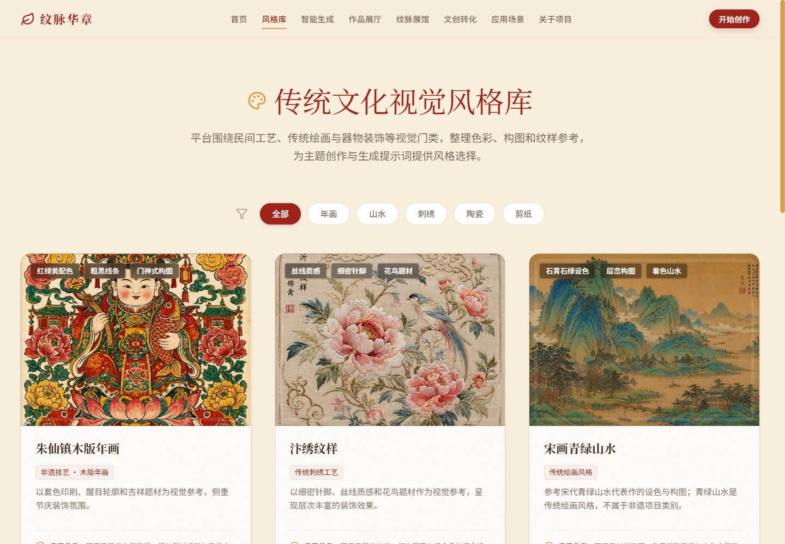](docs/screenshots/current/culture-styles.jpg) | [](docs/screenshots/current/creation-workspace.jpg) |
| 查看风格资料与代表图 | 图示载入真实已保存作品，保留记录来源提示 |

### 生成即入展，互动按本图自动构建

成功作品自动保存参考图、成图、参数、文化卡与元数据。后台先由本地 Qwen3-VL 读取整图与实际局部，再生成本件专属热点和三章叙事，配合本地深度估计构建画境。展厅显示进度，完成后自动开放三个入口，**无需人工写作品文案或重启前端**。

新生成作品的图片下方提供删除按钮；确认后移除本件作品与对应互动，更新展馆作品池。五件原始精选案例受保护。本机私有回收副本用于恢复，不进入公开仓库。

[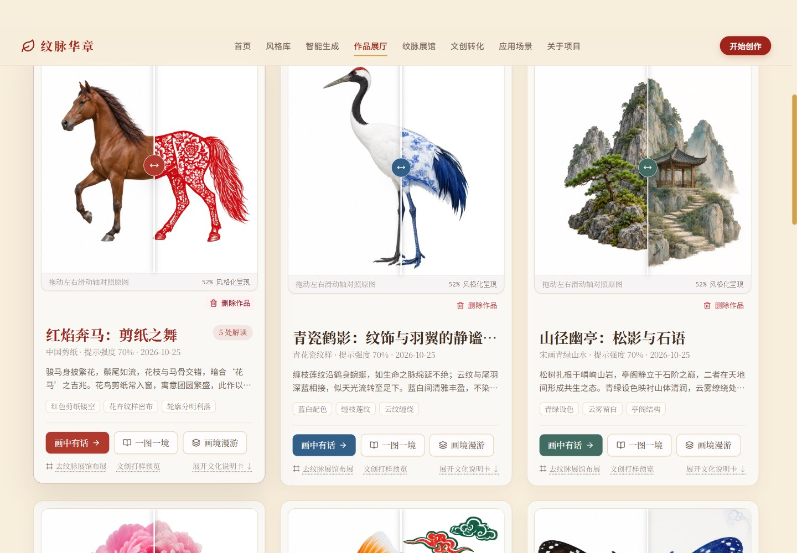](docs/screenshots/current/gallery.jpg)

### 同一件作品，三种阅读方式

| 画中有话 | 一图一境 |
|:---:|:---:|
| [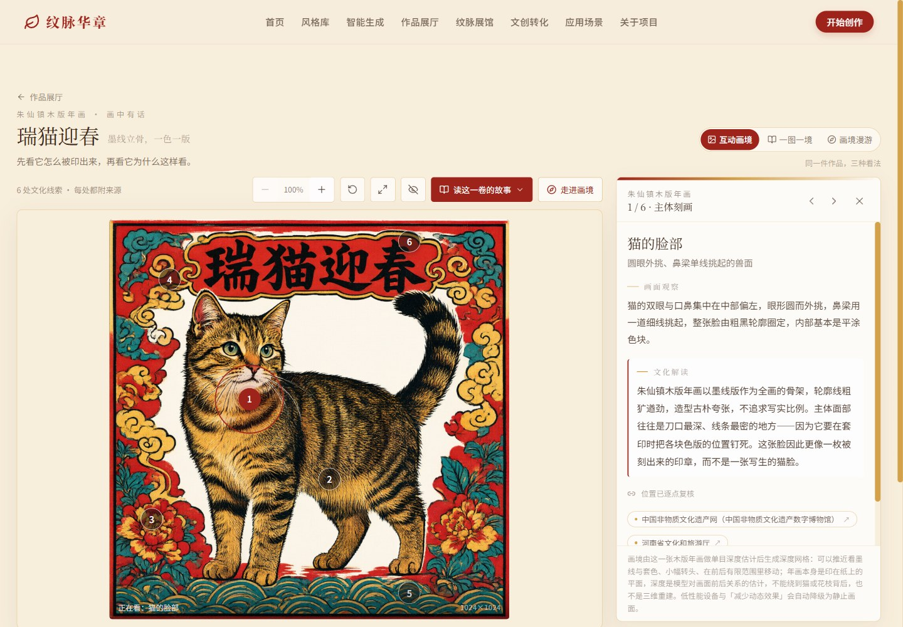](docs/screenshots/current/interactive-artwork.jpg) | [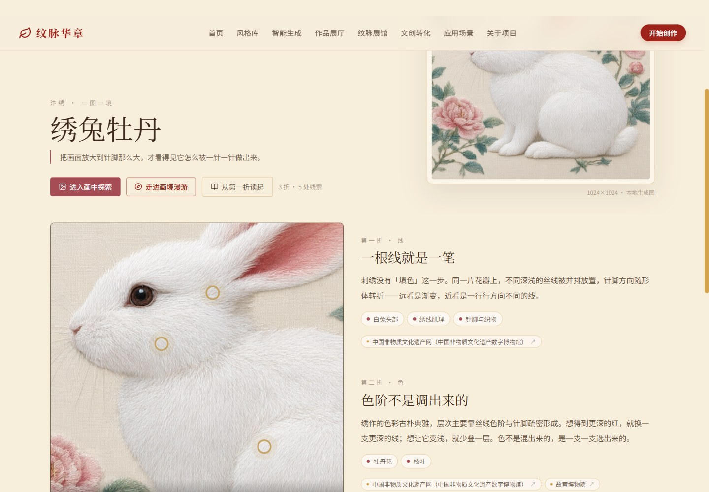](docs/screenshots/current/story-reading.jpg) |
| 热点、局部观察、审美解读与文化背景来源 | 三章图文阅读，章节焦点连接同件作品 |

**画境漫游**使用本图深度与图层提供有限视角的 2.5D 体验，支持推进、转头和热点点击。山水采用平滑深度网格；确认白底的平面主体保留完整轮廓进行分层视差，减少细长轮廓的拉扯。它不恢复物体背面，也不是有骨骼的角色动画。

[](docs/verification/20261025/white-reference/qinghua-world-side.jpg)

### 在经典纹脉展馆里布展

保留原有两层经典展馆与 Antigravity 界面。Three.js 展示预制 Blender / GLB 建筑，支持室内外机位、第一/第三人称、昼夜、15 个画框换画、14 类器物 DIY、灵宠纹纹与本机布展保存。正式版本使用一座经典展馆。

| 经典展馆 | 换画与布展 |
|:---:|:---:|
| [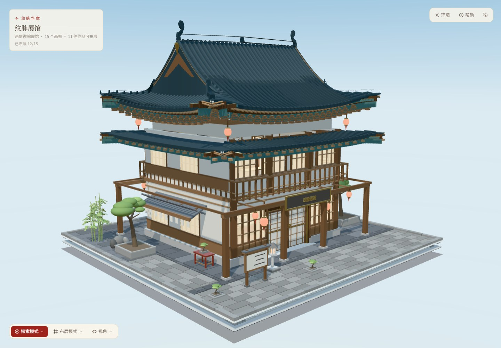](docs/screenshots/current/heritage-gallery.jpg) | [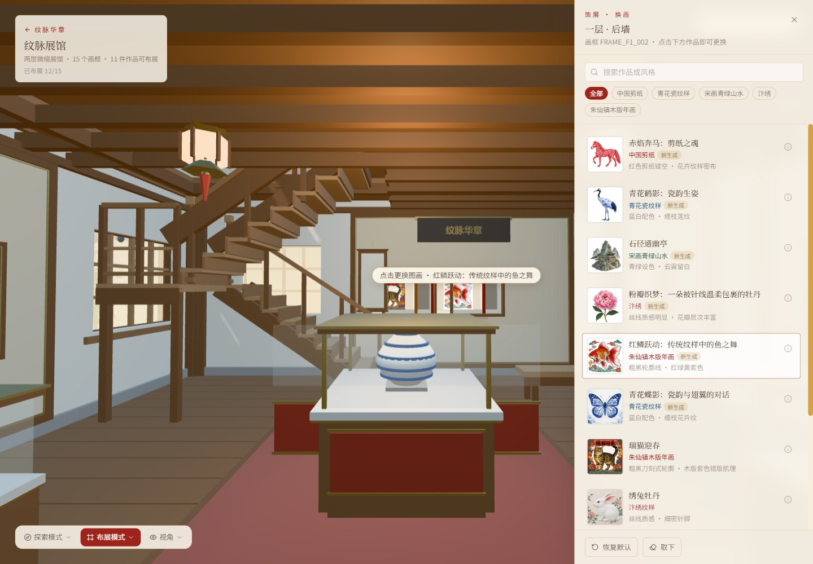](docs/screenshots/current/heritage-diy.jpg) |

### 从作品到文创预览

支持明信片、海报、帆布袋、书签、杯垫、手机分享图、展陈屏与纪念票八类载体，提供版式预览和 **1600×1200 PNG** 输出；文化说明卡可导出 **1080×1440 PNG**。预览用于设计探索，不等于实物生产或印前交付文件。

[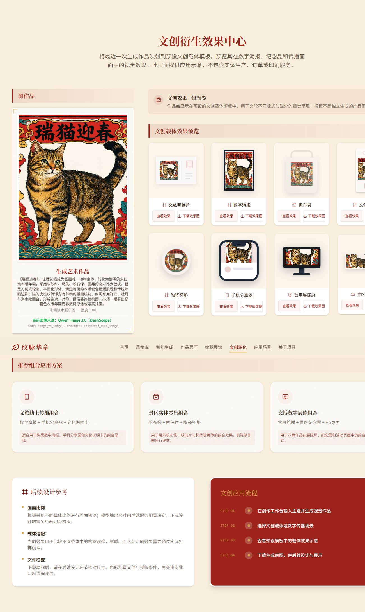](docs/screenshots/current/creative-products.jpg)

<details>
<summary>六组应用场景与六大动态能力矩阵</summary>

| 应用场景 | 关于项目 |
|:---:|:---:|
| [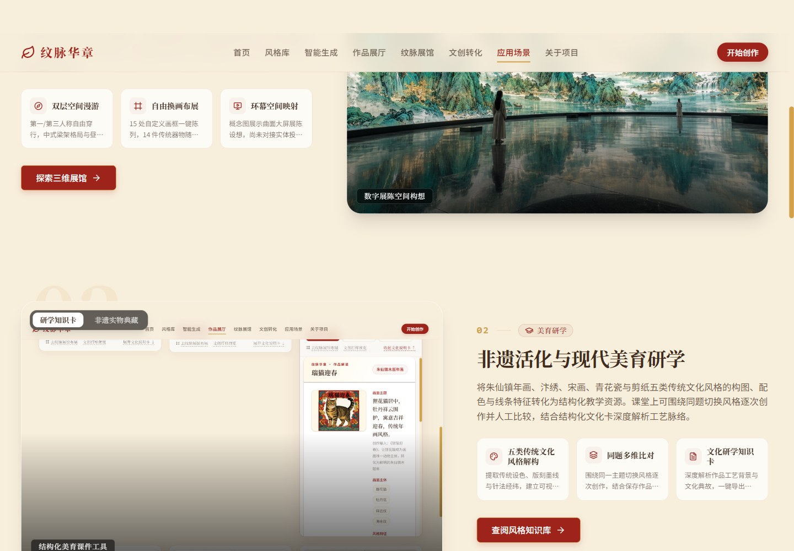](docs/screenshots/current/scenarios.jpg) | [](docs/screenshots/current/about-gallery-capability.jpg) |

应用场景包括数字展馆、美育研学、文创器物、创作工坊、互动导览和线上传播。场景页部分配图是 AI 概念素材，表示应用构想，不是已部署的实体场馆或商品照片。界面排版与动态交互继续沿用 Antigravity 成果。

</details>

## 产品特色

- 五类风格资料与用户主题、参考图一起组织为可控生成条件。
- 文化卡读取实际成图；新互动进一步逐局部读取，作品身份始终绑定独立 `caseId`。
- 从自动入展、赏析、虚拟布展到文创预览共享作品数据。
- 模型解析、后台任务、深度来源与图片哈希保留证据，失败明确呈现。

## 技术架构

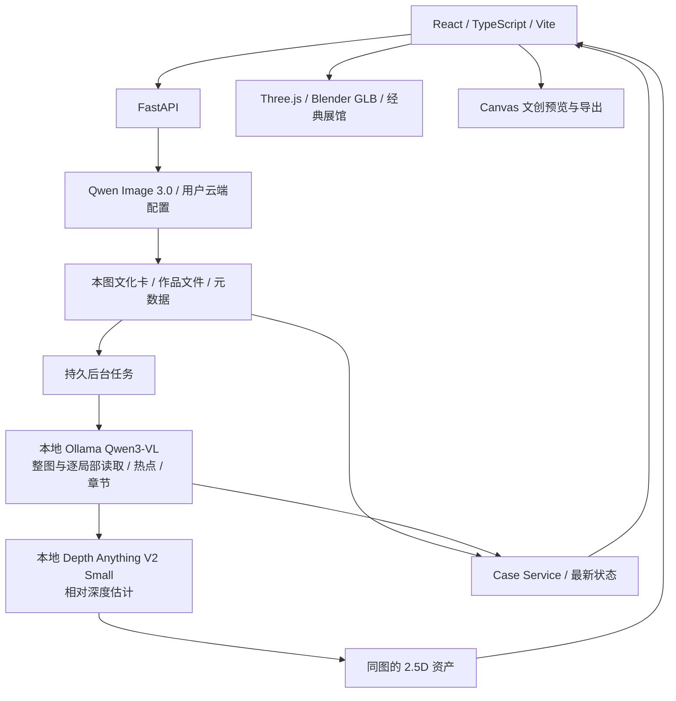

Qwen3-VL 负责观察与叙事，深度模型只辅助空间呈现；项目使用第三方基础模型，不宣称自训练或自研这些模型。没有数据库或多用户账号系统。详见 [架构与接口](docs/architecture.md)、[自动构建流程](docs/interactive/NEW_CASE_PIPELINE.md)、[模型依赖与交付](models/README.md)。

## 真实作品案例

原有五组参考图、真实成图、文化卡与来源证据完整保留：

| 年画 · 瑞猫迎春 | 汴绣 · 绣兔牡丹 | 宋画 · 云鹤临水楼 | 青花 · 青花蝶韵 | 剪纸 · 剪影灵狐 |
|:---:|:---:|:---:|:---:|:---:|
| [](docs/examples/zhuxianzhen/metadata.json) | [](docs/examples/bianxiu/metadata.json) | [](docs/examples/songhua/metadata.json) | [](docs/examples/qinghua/metadata.json) | [](docs/examples/jianzhi/metadata.json) |

[查看参考图 → 参数 → 成图 → 文化卡的完整案例](docs/examples/README.md)。

2026-10-25 另用五张不同的 AI 白底测试参考图，真实生成了年画金鱼、汴绣牡丹、青绿山亭、青花丹顶鹤和剪纸骏马，并检查自动入展与三种互动。[本轮真实结果、对照和浏览器记录](docs/verification/20261025/README.md)。

## 安装与运行

环境：Python 3.10+；Node.js 20.19+ 或 22.12+。运行现有 TypeScript 测试建议 Node.js 22.18+。完整创作还需要个人百炼配置、Ollama Qwen3-VL 和本地深度模型。

在项目根目录执行：

```powershell
.\setup_windows.cmd

# 完整自动互动环境：首次安装一次
.\backend\venv\Scripts\python.exe -m pip install -r backend/requirements-interactive.txt
.\backend\venv\Scripts\python.exe scripts/setup_interactive_models.py
ollama pull qwen3-vl:4b-instruct-q4_K_M

.\check_environment.cmd
.\start_windows.cmd
# 使用完毕
.\stop_windows.cmd
```

从 `backend/.env.example` 配置本机 `backend/.env`：填写个人 `DASHSCOPE_API_KEY` 与百炼业务空间专属 `DASHSCOPE_BASE_URL`；保留本地 `QWEN_VL_ENABLED=true`、实际模型名称和 `WENMAI_DEPTH_MODE=model`。密钥只留在后端，不提交 GitHub。

Ollama 已运行时不用重复启动，模型已安装时不用重下。启动器打印实际前后端端口，默认打开展厅；停止脚本核对进程身份并保留 Ollama。已保存作品、经典展馆和文创预览无需调用付费生图服务。[完整运行说明与故障处理](docs/running.md)。

## 项目结构

```text
frontend/src/           页面、案例读取、互动体验、2.5D 与经典展馆
frontend/public/       风格图、经典 GLB、已构建画境及场景素材
backend/               FastAPI、模型调用、文化卡、案例与后台任务
scripts/interactive/   本图解析接入、深度估计与画境构建
models/                模型来源、固定版本、许可与校验说明
culture_knowledge/     文化背景与来源注册表
assets/                原始设计与正式模型工程
docs/examples/         真实案例、输入、文化卡与互动数据
docs/screenshots/current/  当前正式真实界面截图
docs/verification/     可核查的运行验收资料
docs/history/          保留的历史记录与旧截图
tests/                 后端与流水线回归测试
```

## 功能状态与限制

本轮真实验证涵盖五种白底参考图生成、自动保存、本地整图与局部解析、三个互动入口及画境操作。TypeScript、前端测试、后端测试和构建结果详见 [正式审计记录](docs/RELEASE_AUDIT_20261025.md)，不沿用历史测试数字作为本轮结果。

- 云端生成需要合法服务与额度；没有密钥时仍可浏览已保存作品。
- 新图自动互动需要本地 Qwen3-VL 与已安装的深度环境。构建异步完成，失败可重试，不撤销成图。
- 自动观察、文化解读、热点和相对深度可能有偏差，不作历史事实核验或测量依据。
- 2.5D 是有限视角，不是完整三维重建；弱设备可回落静态视差。
- GitHub Pages 只读展示；实时推理、作品删除和新作品保存需要本地后端。
- 场景概念图与文创样机表示设计探索，不代表商业部署或实物制造。

## 开源协议与来源

代码沿用 [MIT](LICENSE)，保留既有 Apache-2.0 声明及 [第三方组件说明](THIRD_PARTY_NOTICES.md)。模型遵循各自许可，MIT 不覆盖第三方权重与云端服务条款。

[素材与模型资产](assets/README.md) · [案例参考图来源](docs/examples/reference_sources.md) · [截图来源](docs/screenshots/README.md) · [历史资料](docs/history/)
