<div align="center">

# 纹脉华章

### 传统文化视觉智能创作与文创应用平台

从主题与参考图出发，让传统视觉风格进入数字创作、文化阅读和文创设计。

**[在线体验](https://3331083641-prog.github.io/wenmai-huazhang/#/)** · **[功能展示](#最新界面)** · **[快速开始](#快速开始)** · **[技术架构](#技术架构)** · **[项目源码](https://github.com/3331083641-prog/wenmai-huazhang)**

[下载源码 ZIP](https://github.com/3331083641-prog/wenmai-huazhang/archive/refs/heads/main.zip) · [浏览真实案例](https://3331083641-prog.github.io/wenmai-huazhang/#/gallery) · [MIT 许可](LICENSE)

</div>

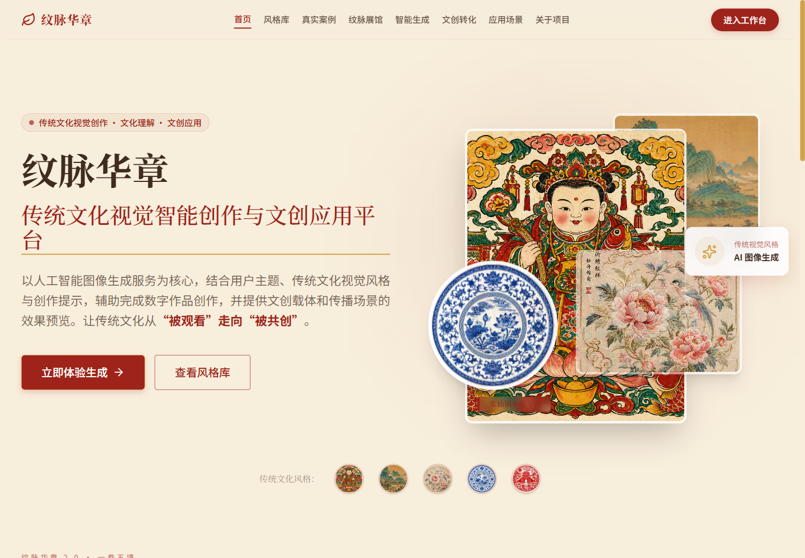

> **在线体验是静态浏览版**：可阅读保存案例、文化说明与互动内容，浏览文创模板和三维展馆；实时 AI 生成需在本机启动后端并配置个人服务。在线页面不提供开发者密钥，也不运行云端或本地模型。

## 从一张图，走到一座展馆

纹脉华章面向文化创作者、校园美育与文旅概念设计：将五类传统视觉风格整理为可选择的色彩、纹样和构图提示，通过 Qwen Image 生成作品，再由本机 Qwen3-VL 阅读实际成图，形成文化说明。作品可继续映射到八种文创载体，也可从热点线索、三折故事和有限视差画境重新观看。

三维展馆提供独立的预制建筑场景，可切换内外视角、漫游和布展。它与单图深度驱动的画境分别实现，共用项目里可追溯的真实作品。

**选择风格 → 输入主题 / 参考图 → 生成作品 → 阅读文化卡 → 文创预览 / 互动展陈**

## 最新界面

以下均为 **2026-10-24 实际运行截图**，以约 1440 像素宽桌面视口采集，部分页面保留完整页面高度；没有使用 AI 界面效果图。[截图采集说明](docs/screenshots/README.md)。

### 创作：参考图、提示控制与结果同屏

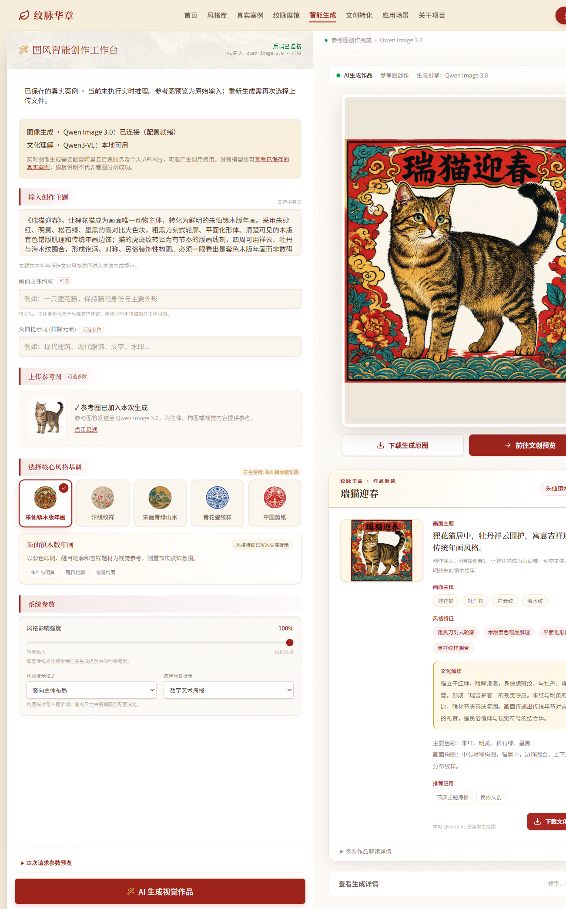

工作台图中通过展厅真实按钮载入了内置「瑞猫迎春」保存记录，界面明确标注其来源；它展示当前 UI 与既有作品，**不是本轮接口新生成的结果**。主题、主体约束、构图、用途、风格影响强度与负向提示均可在本地实时创作中使用。

| 文化风格库 | 真实作品展厅 |
|:---:|:---:|
| [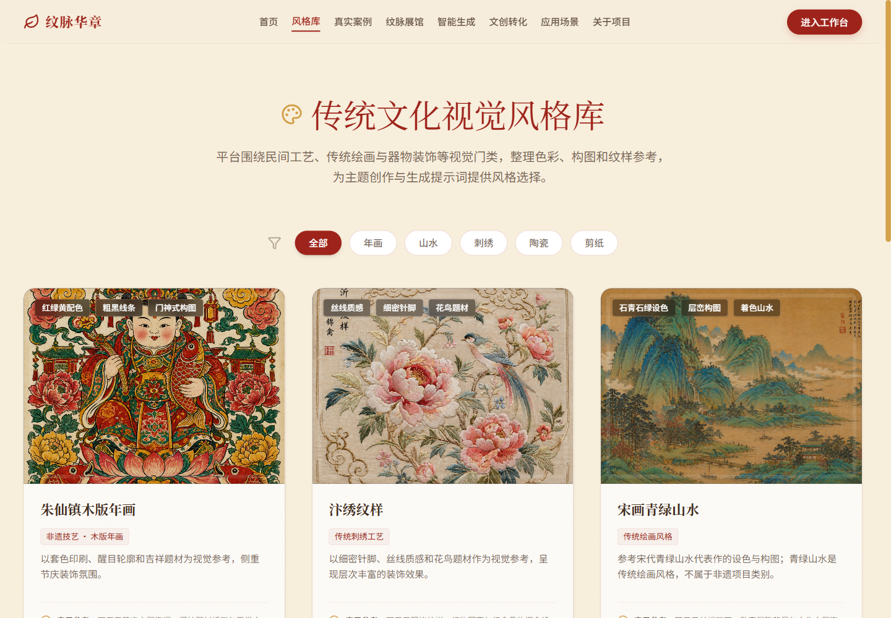](docs/screenshots/culture-styles.png) | [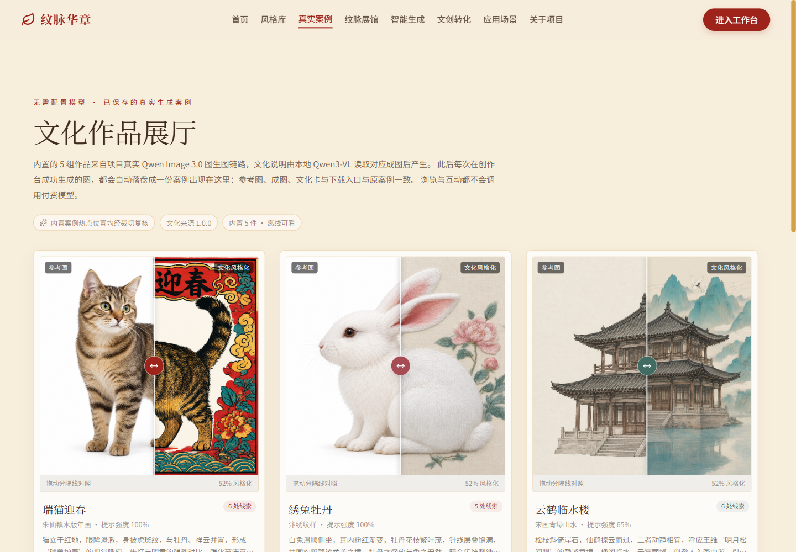](docs/screenshots/gallery.png) |
| 五种风格各自说明色彩、视觉特征与适用场景 | 参考与成图对照，连接文化卡、互动阅读及文创预览 |

### 理解：读画面的细节，也追溯文化来源

| 画中有话 | 一图一境 |
|:---:|:---:|
| [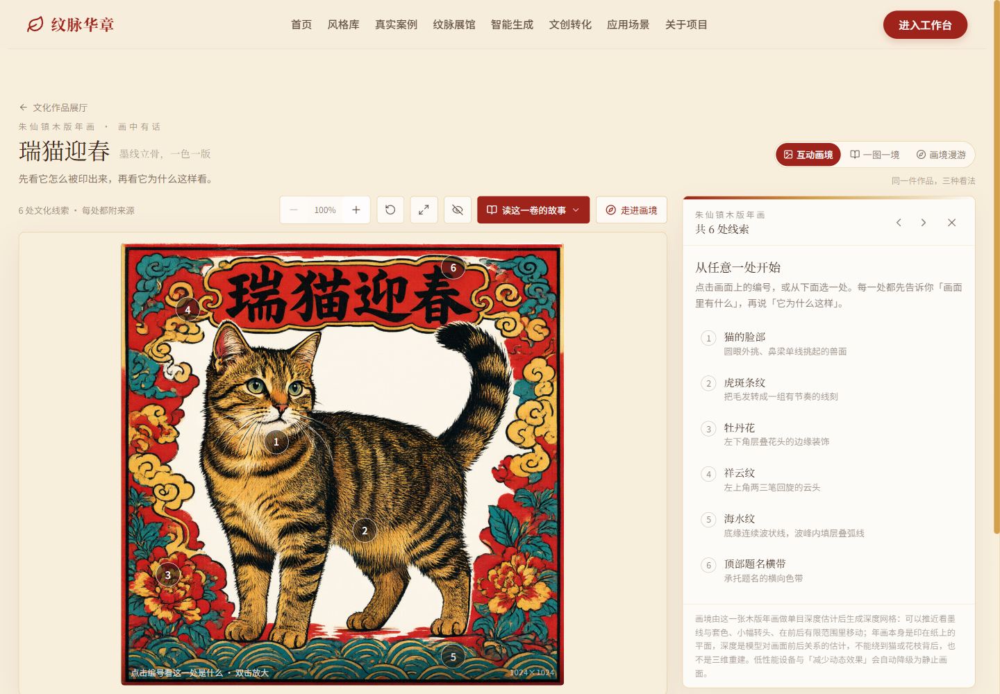](docs/screenshots/interactive-artwork.png) | [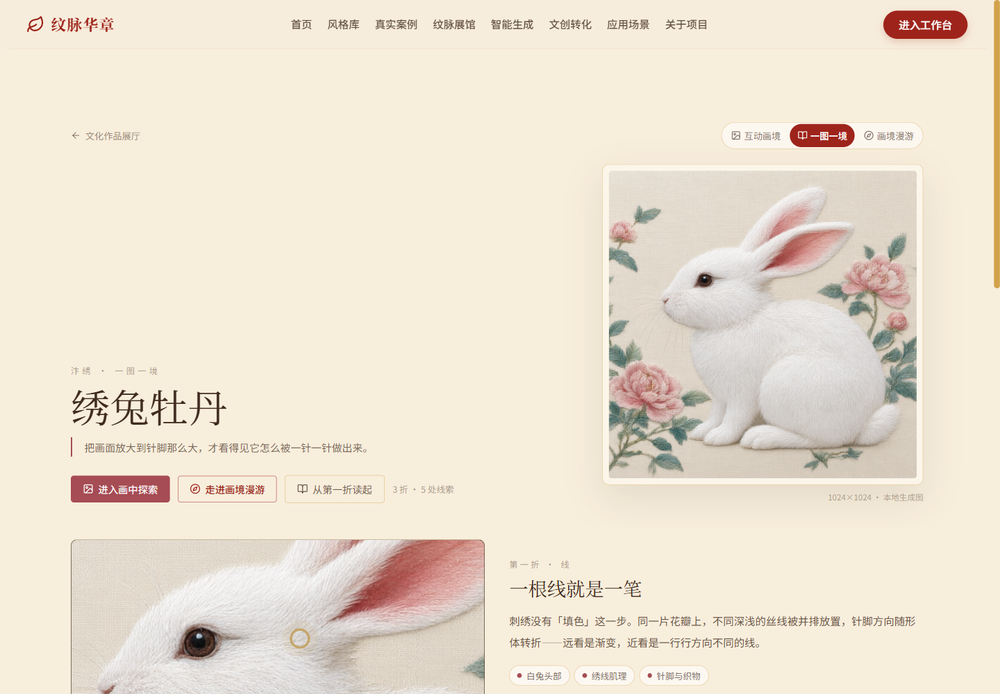](docs/screenshots/story-reading.png) |
| 五件作品、25 处线索；区分画面观察、文化解读和来源 | 每件作品三折，随阅读改变画面焦点，支持章节定位 |

| AI 文化说明卡 | 文创应用预览 |
|:---:|:---:|
| [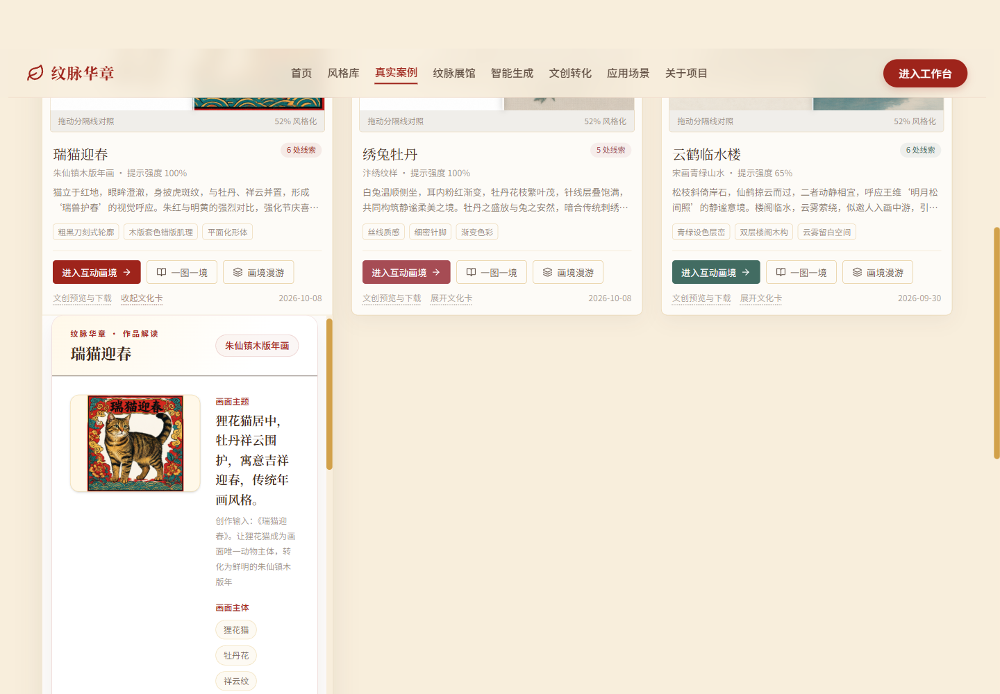](docs/screenshots/culture-card.png) | [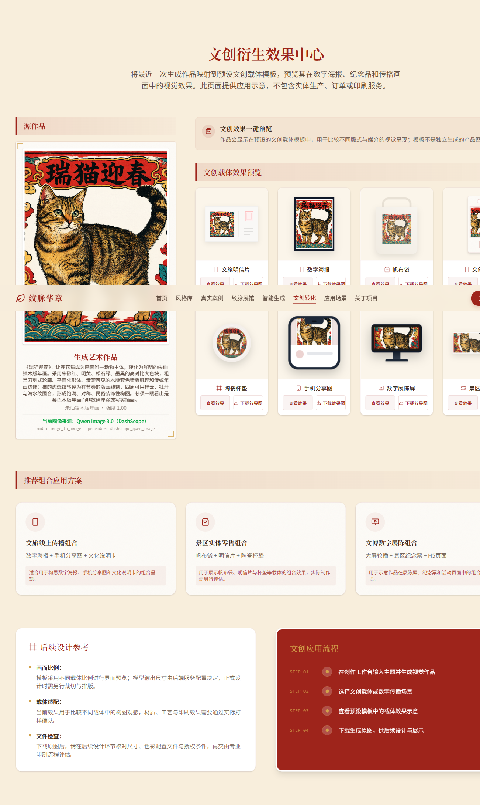](docs/screenshots/creative-products.png) |
| 结构化主体、色彩、构图与文化解读，可导出 1080×1440 PNG | 作品映射到八类载体，可导出 1600×1200 PNG 效果图 |

### 展陈：进入画境，走进三维展馆

| 画境漫游 · 2.5D | 纹脉展馆 · 三维场景 |
|:---:|:---:|
| [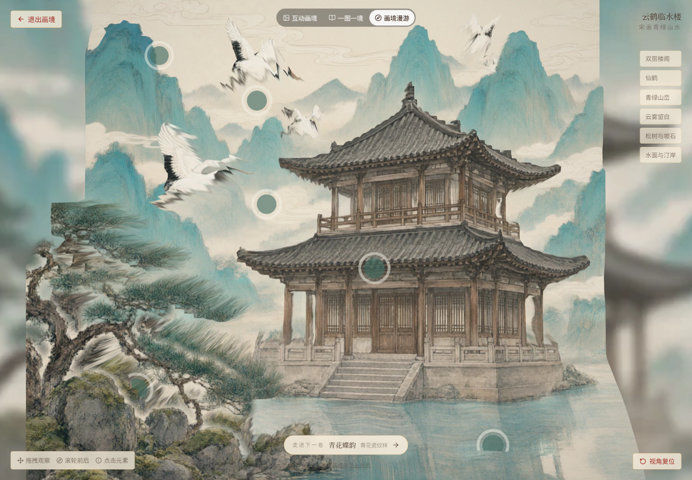](docs/screenshots/painting-world.png) | [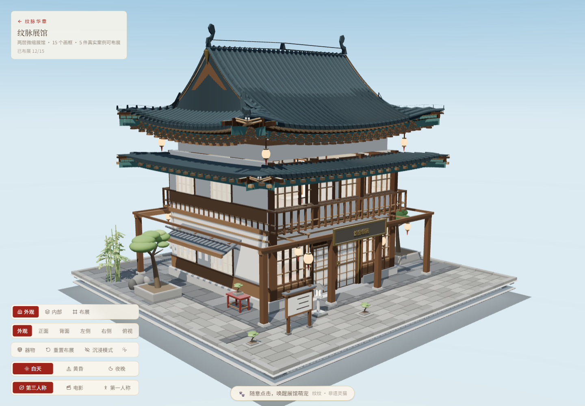](docs/screenshots/heritage-gallery.png) |
| 五件案例已有深度素材；推进镜头、有限转头与热点探索 | 预制 GLB 建筑、内外机位、昼夜、布展与器物交互 |

<details>
<summary>展开查看：三维展馆内部</summary>

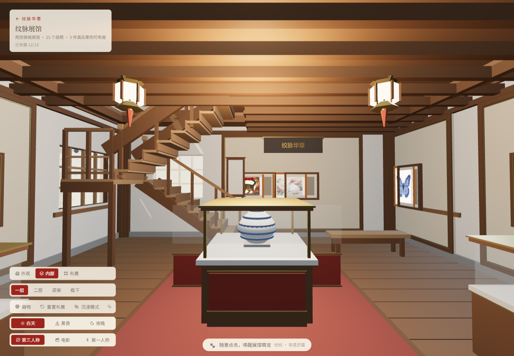

展馆可环绕旋转和缩放，切换第一人称、电影视角，使用画框换画和 DIY 器物布展。布展偏好保存在当前浏览器；馆内挂画清单目前来自五件精选案例。

</details>

## 核心功能

1. **五种传统视觉风格**：朱仙镇木版年画、汴绣纹样、宋画青绿山水、青花瓷纹样、中国剪纸。风格介绍素材与生成用主体参考图分开管理。
2. **文本与参考图联合创作**：百炼 `qwen-image-3.0` 处理主题和可选参考图；前端提供上传预览、主体约束、构图与用途控制，生成图片可保存下载。
3. **可解释的参数控制**：风格影响强度调整 Prompt 中的风格强调，负向提示表达排除倾向；两者都不等于额外训练或质量保证。
4. **基于实际成图的文化说明**：Ollama 上的 `qwen3-vl:4b-instruct-q4_K_M` 输出主体、主色、构图、视觉特征和文化阐释；模型失败时明确标记模板回退，保留已生成图片。
5. **八种文创效果**：明信片、海报、帆布袋、书签、杯垫、手机分享图、数字展陈屏、纪念票；均为预设载体映射，支持 PNG 导出。
6. **作品与证据管理**：五组精选案例随项目提供；本地新作可自动保存参考、成图、文化卡和元数据，通过 `/cases` 进入展厅。最近作品存于浏览器，持久案例存于本机文件目录。
7. **文化互动阅读**：热点缩放拖拽、键盘切换、来源链接与三折叙事；五件已烘焙画境具备有限 2.5D 视差，低性能设备可降级静态阅读。
8. **可操作的三维展馆**：建筑内外浏览、机位和昼夜切换、第一人称 / 电影视角、画框换画、14 件器物目录与 DIY 布展，并保留角色探索模块。它使用预制模型，不能将任意生成图片自动还原成三维建筑。

<details>
<summary>实验能力与尚未实现的范围</summary>

- **新作自动互动构建为扩展流水线**：`scripts/interactive/ingest_case.py` 尝试生成热点、三折叙事和深度画境。基础安装未包含完整深度推理依赖与权重，标准运行不保证该步骤成功；自动热点标记 approximate / pending，需人工复核。
- 新互动数据由 Vite glob 编译载入，后台完成后需重启开发服务器或重新构建；静态 Pages 还需重新部署。普通运行期案例可以通过 `/cases` 刷新读取。
- 单张图深度是估计的前后关系，画境只能有限转动和推进，不恢复被遮挡的背面。当前 V5 展馆保留 GLB 的 PBR 颜色，默认三渲二开关关闭。
- “纹脉星球”仍是调研；未实现多用户账户、商品交易、实体打印终端、实时大屏同步、独立参数批量消融对比平台。

详见 [功能与正式入口审计](docs/FEATURE_AUDIT_20261024.md) 和 [运行边界](docs/running.md)。

</details>

## 五组真实作品案例

下列保留作品来自已有真实请求，原始日期、参数、模型、参考图参与信息、SHA-256 和视觉分析见每组 `metadata.json`。文化卡由应用实际导出，图片不是本轮重新生成。

| 风格 / 作品 | 参考输入 | 真实 Qwen Image 3.0 作品 | 实际导出 CultureCard |
|---|---|---|---|
| 朱仙镇木版年画<br>瑞猫迎春 | [原尺寸](docs/examples/zhuxianzhen/reference.png)<br> | [原尺寸](docs/examples/zhuxianzhen/generated.png)<br>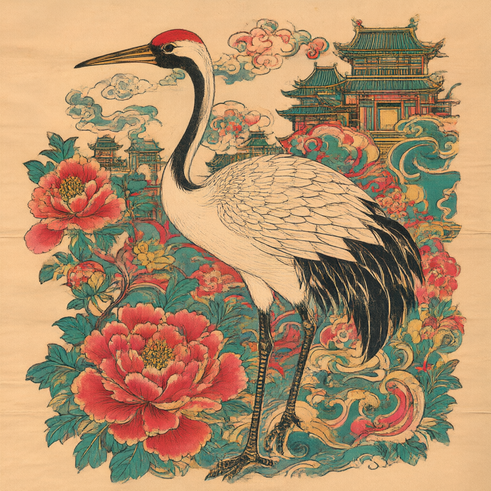 | [原尺寸](docs/examples/zhuxianzhen/culture_card.png)<br>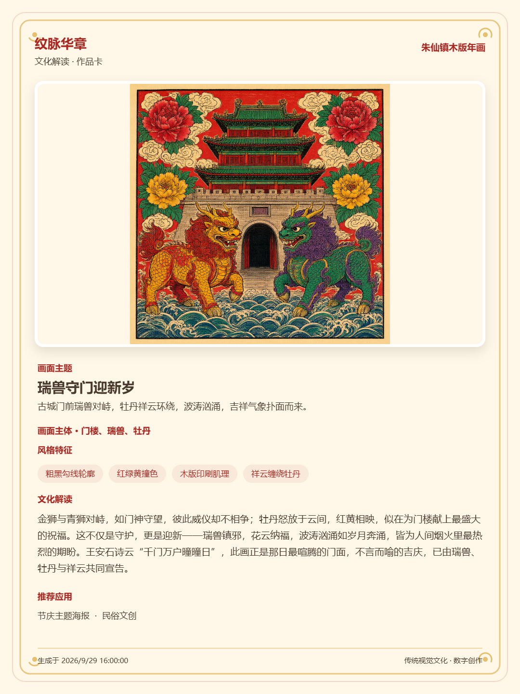 |
| 汴绣纹样<br>绣兔牡丹 | [原尺寸](docs/examples/bianxiu/reference.png)<br> | [原尺寸](docs/examples/bianxiu/generated.png)<br> | [原尺寸](docs/examples/bianxiu/culture_card.png)<br>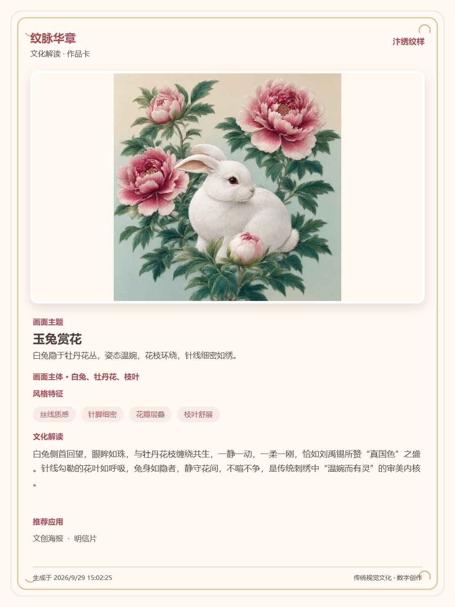 |
| 宋画青绿山水<br>云鹤临水楼 | [原尺寸](docs/examples/songhua/reference.png)<br>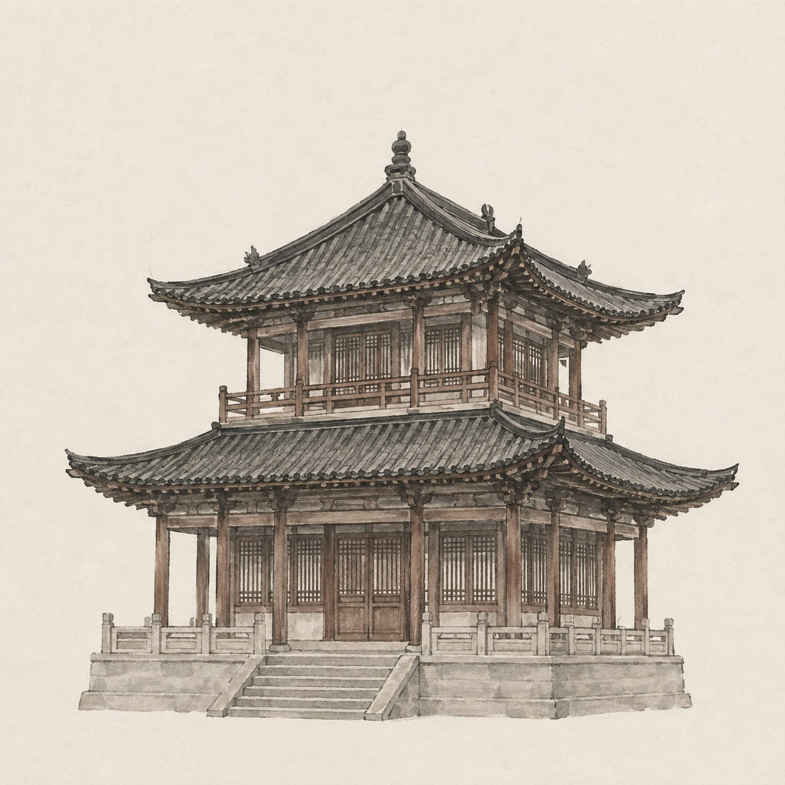 | [原尺寸](docs/examples/songhua/generated.png)<br> | [原尺寸](docs/examples/songhua/culture_card.png)<br>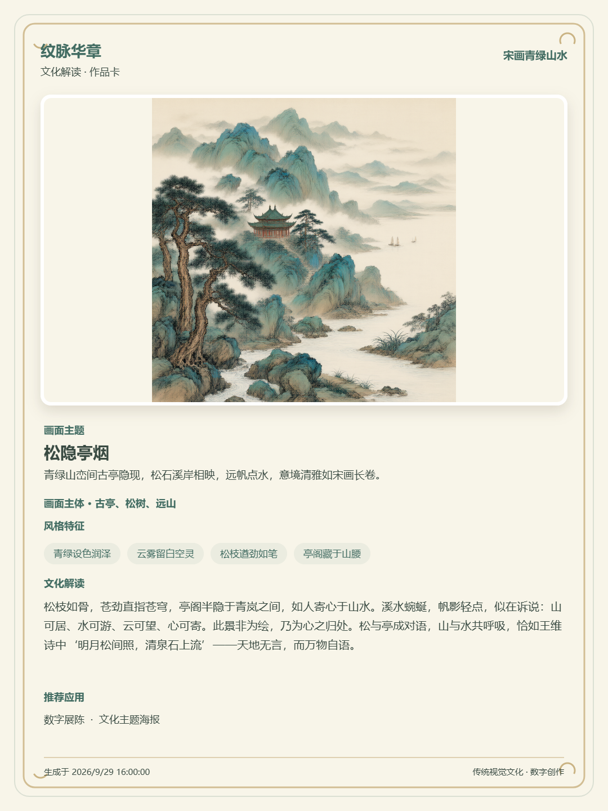 |
| 青花瓷纹样<br>青花蝶韵 | [原尺寸](docs/examples/qinghua/reference.png)<br> | [原尺寸](docs/examples/qinghua/generated.png)<br>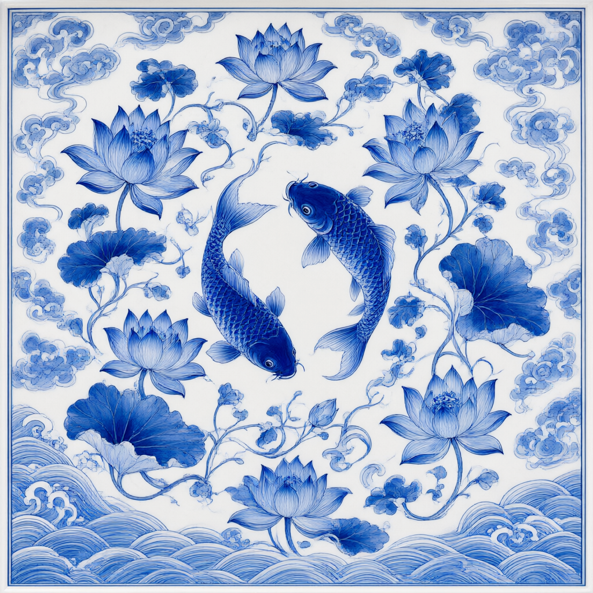 | [原尺寸](docs/examples/qinghua/culture_card.png)<br>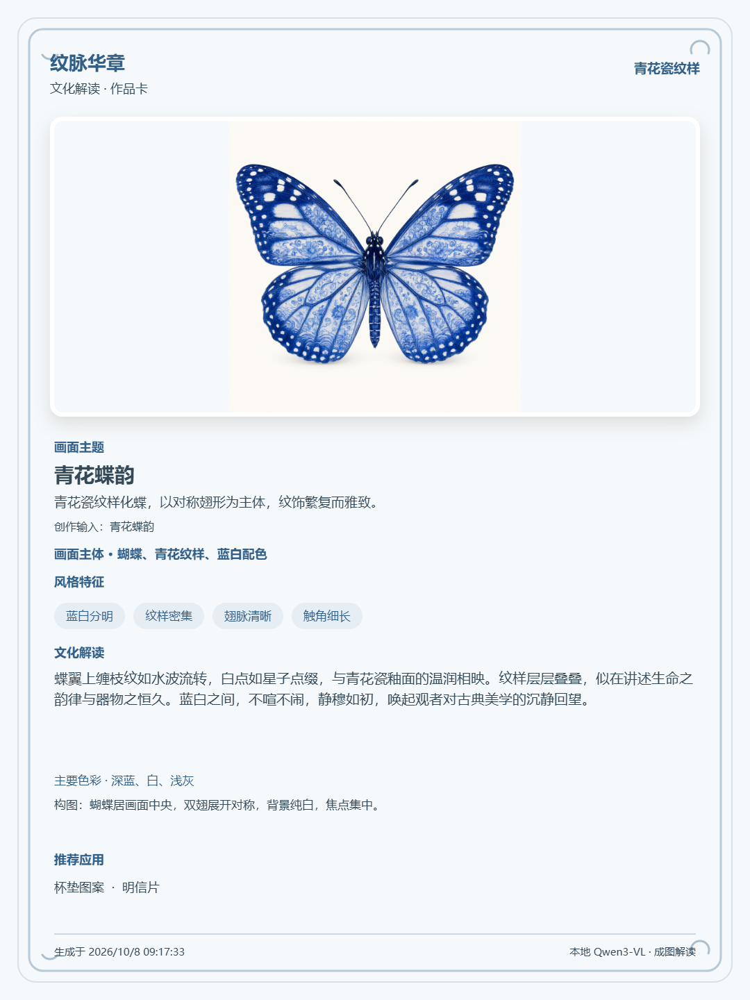 |
| 中国剪纸<br>剪影灵狐 | [原尺寸](docs/examples/jianzhi/reference.png)<br> | [原尺寸](docs/examples/jianzhi/generated.png)<br> | [原尺寸](docs/examples/jianzhi/culture_card.png)<br>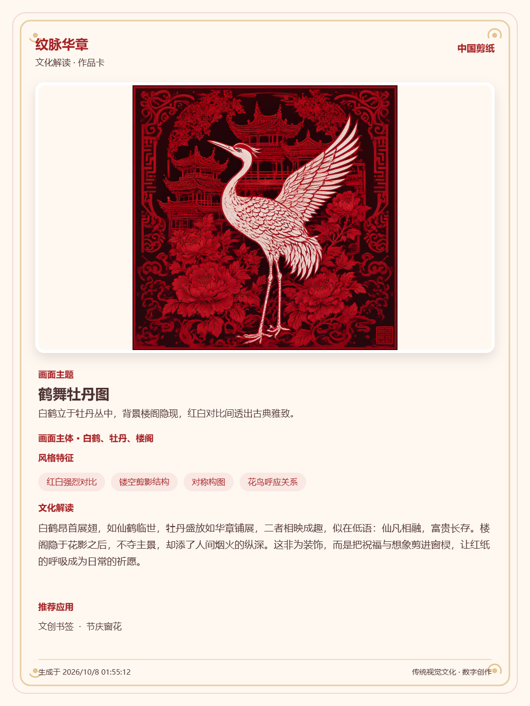 |

可复现的观看顺序是：**参考输入 → 查看创作参数 → 真实生成作品 → 文化卡 → 从展厅进入文创预览**。风格、主体和提示强度概览如下，详细提示与证据见 [案例说明](docs/examples/README.md)。

| 风格 | 主体参考 | 风格提示强度 | 原始生成日期 | 元数据 |
|---|---|---|---|---|
| 朱仙镇木版年画 | 狸花猫 | 100% | 2026-10-08 | [metadata](docs/examples/zhuxianzhen/metadata.json) |
| 汴绣纹样 | 白兔 | 100% | 2026-10-08 | [metadata](docs/examples/bianxiu/metadata.json) |
| 宋画青绿山水 | 双层古典楼阁 | 65% | 2026-09-30 | [metadata](docs/examples/songhua/metadata.json) |
| 青花瓷纹样 | 蝴蝶 | 65% | 2026-10-08 | [metadata](docs/examples/qinghua/metadata.json) |
| 中国剪纸 | 赤狐 | 65% | 2026-10-08 | [metadata](docs/examples/jianzhi/metadata.json) |

输入参考包含授权用于本项目的 AI 图像，楼阁参考不是历史实物照片；相关来源与权限见 [参考素材记录](docs/examples/reference_sources.md)。年画猫的真实输出保留了题字，说明负向文字约束未完全生效；不为展示效果修饰或替换模型输出。

## 技术架构

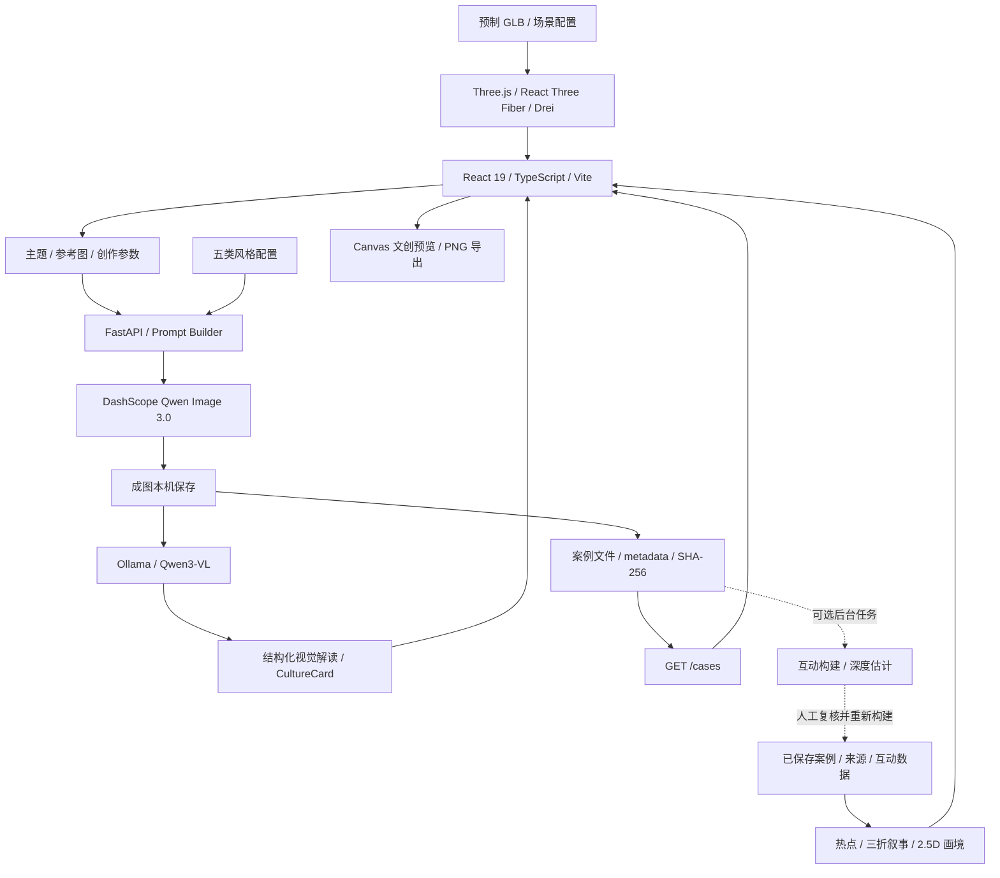

前端采用 React Router、Tailwind CSS、Motion、Zod 和 Zustand；后端采用 FastAPI、Pydantic、Pillow 与 Requests。作品使用本机文件保存，没有独立数据库；布展使用浏览器 LocalStorage。文化来源集中于 `culture_knowledge/`，不是在线检索增强服务。

[完整架构与接口](docs/architecture.md) · [运行与故障处理](docs/running.md)

## 项目特色

- **从文化条目走到生成约束**：每类风格的色彩、纹样和构图有明确提示来源，上传主体参考图与风格展示素材各司其职。
- **让说明对应实际画面**：先生成并保存图片，再提交视觉模型解读；模型不可用时在数据和界面保留回退标记。
- **把一件作品串成完整体验**：同一份真实案例连接参考对照、文化卡、文创导出、热点故事和展馆挂画，减少标题、图像与来源错配。
- **展示可追溯**：五组输入、输出、文化卡和元数据完整保留；页面观察、文化阐释、来源和待复核自动内容分别标示。

这些是当前工程和产品设计特点，不声明自训练模型、原创基础算法或未经测量的准确率与性能优势。

## 快速开始

### Windows 一键运行

需要 **Python 3.10+、Node.js 20.19+ 或 22.12+、npm**；运行现有前端 TypeScript 测试建议 Node.js 22.18+ 或 24。实时文化理解另需 Ollama，首次安装项目依赖需要联网。

下载源码并解压，在项目根目录双击相应脚本，或运行：

```powershell
.\check_environment.cmd
.\setup_windows.cmd
# 首次安装后，编辑 backend/.env，填写个人百炼配置
.\start_windows.cmd
# 使用完毕
.\stop_windows.cmd
```

`setup_windows.cmd` 创建项目虚拟环境、安装前后端依赖、准备风格素材，缺少配置时从示例建立私有配置。启动器选择空闲端口并传递前后端地址，默认打开作品展厅；停止器仅关闭自身记录且创建时间匹配的进程，保留共享 Ollama。脚本不安装系统 Python / Node，也不下载大模型。

### 配置图像生成与本地文化理解

仅在本机编辑 `backend/.env`，参照 [配置模板](backend/.env.example) 填写自己的百炼 API Key 与北京业务空间专属 HTTPS 地址。密钥不进入前端或 Git。

```dotenv
GENERATION_PROVIDER=dashscope_qwen_image
ALLOW_MOCK_FALLBACK=false
DASHSCOPE_API_KEY=
DASHSCOPE_BASE_URL=
DASHSCOPE_IMAGE_MODEL=qwen-image-3.0
QWEN_VL_ENABLED=true
QWEN_VL_BASE_URL=http://127.0.0.1:11434
QWEN_VL_MODEL=qwen3-vl:4b-instruct-q4_K_M
QWEN_VL_TIMEOUT=180
# 未准备扩展深度环境时，先关闭新作后台互动构建
AUTO_BUILD_INTERACTIVE=false
```

上面的两个空值需填写个人配置。已有 Ollama 模型可直接使用；未安装时执行：

```powershell
ollama pull qwen3-vl:4b-instruct-q4_K_M
# 仅在 Ollama 服务尚未运行时执行
ollama serve
```

**没有生成密钥也可使用**：保存案例、风格介绍、文化卡阅读、文创效果、既有热点故事、画境和展馆。**实时图像生成**需要个人服务开通和额度；**新作品的真实视觉解读**需要可用的本地模型。云端调用可能计费，不批量重试。

<details>
<summary>手动安装、启动与常见问题</summary>

先按 [完整运行说明](docs/running.md) 安装 `backend/requirements.txt` 与前端锁定依赖，准备私有配置。后端在 `backend` 目录运行：

```powershell
.\venv\Scripts\python.exe -m uvicorn app:app --host 127.0.0.1 --port 8000
```

前端在 `frontend` 目录运行：

```powershell
npm ci
npm run dev
```

验证顺序为 **后端 `/health` → 后端 `/generate` → 前端 `npm run dev` → 浏览器**。接口结构见运行中后端 `/docs`。自定义后端地址时设置 `VITE_API_BASE_URL`；本机开发使用新终端，避免遗留 Pages 构建变量。

| 现象 | 处理入口 |
|---|---|
| 生成服务断连或失败 | 检查实际端口、`/health`、个人配置、服务额度和网络；失败不以演示图片冒充成功 |
| 文化卡标记模板 | 检查 Ollama、本机模型名与 `/health` 中视觉状态；列出模型不等于已通过看图推理 |
| 新作没有互动入口 | 检查 `/interactive-jobs`、扩展依赖及待复核数据，重启 dev / 重新构建 |
| 画境降级或展馆加载慢 | 检查 WebGL2、设备能力与模型资源；画境低性能时会降为静态 |

macOS / Linux 的虚拟环境路径与 Windows 不同，详见运行说明。

</details>

## 项目目录

```text
wenmai-huazhang/
├─ frontend/                React 应用、11 条正式路由与测试
│  ├─ src/features/         文化互动、2.5D 画境、三维展馆
│  └─ public/               风格图片、已烘焙画境与运行时 GLB
├─ backend/                 FastAPI、生成 provider、视觉理解、案例保存
├─ culture_knowledge/       五类文化条目与来源注册表
├─ assets/                  风格规范素材、模型编辑源和历史设计资产
├─ docs/
│  ├─ screenshots/          最新真实运行截图
│  ├─ examples/             五组真实案例及元数据
│  └─ interactive_v2/       互动迭代和研究记录
├─ scripts/                 Windows 启动器、素材准备与扩展互动流水线
├─ tests/                   后端与交付回归检查
├─ tools/                   保留的场景工具与测试查看器
├─ iCAN_应用方案/            历史赛事资料
├─ licenses/                第三方许可文本
├─ setup_windows.cmd        首次安装
├─ start_windows.cmd        一键启动
└─ stop_windows.cmd         安全停止项目进程
```

配置、依赖环境、运行输出、缓存和日志不属于源码发布内容；历史验收文档保留原日期和结论，当前能力以源码及本轮验证为准。

## 验证与项目状态

2026-10-24 在实际本机环境完成检查，离线测试与真实推理分别记录；[本轮单次生成证据](docs/verification/20261024/metadata.json) 保留公开参数、成图哈希与分析结果：

| 项目 | 本轮结果 |
|---|---|
| 前端测试 | 44/44 通过，覆盖案例、来源、热点几何、数据 schema 和五件画境清单 |
| 后端离线回归 | 20/20 通过；外部请求使用测试替身，不作为真实推理证据 |
| 类型与静态构建 | `npm run lint`、与 Pages 相同配置的构建通过；主 JS 存在大包提示 |
| 真实生成链路 | 按顺序检查健康状态，单次真实 Qwen Image 3.0 图生图成功，`referenceImageUsed=true`；本机 Qwen3-VL 返回 `analysisSource=qwen3_vl`，总请求约 69.91 秒 |
| 作品和导出 | 实际案例载入、参考图上传预览、1080×1440 文化卡及 1600×1200 明信片按钮下载通过 |
| 文化互动与场景 | 热点、三折阅读、2.5D 入画、三维馆外观/内部/昼夜、14 件器物目录和梅瓶落位已操作验证 |
| 失败反馈 | 缺配置、HTTP 503 使用明确的浏览器测试响应检查提示；不计作真实模型调用 |
| Windows 一键启停 | 启动成功；停止后两个根进程及派生进程退出，API/前端端口释放；15 项身份与进程树专项检查在两种 PowerShell 下通过 |

本轮真实请求关闭自动案例保存，保护既有五组案例的配对；截图中的保存作品与本轮新成图分别标识。单次耗时只说明当前设备与服务的一次结果，不能作为性能基准。Windows 真实启停及最终远程部署以本轮验收记录为准。

<details>
<summary>运行相同的离线检查</summary>

```powershell
.\backend\venv\Scripts\python.exe -m unittest discover -s tests -v
Set-Location frontend
npm test
npm run lint
npm run build
```

Pages 由 `.github/workflows/pages.yml` 在 `main` 推送时构建，使用 HashRouter 与仓库子路径；不托管 FastAPI、Ollama 或深度模型。可选浏览器验收工具不属于产品运行依赖。

</details>

[本轮完整验收](docs/LOCAL_SYNC_ACCEPTANCE_20261024.md) · [本轮工程检查](docs/ENGINEERING_AUDIT_20261024.md) · [功能审计与限制](docs/FEATURE_AUDIT_20261024.md) · [既有生成验收记录](docs/AIC_GALLERY_AND_JUDGE_EXPERIENCE_ACCEPTANCE.md)

生成模型可能偏离主体或负向约束；文化阐释是辅助审美说明，不能认证历史实物、馆藏或传统手工原作。文创图是模板效果预览，不是印刷生产文件。三维场景与大体积脚本在低性能设备上可能加载较慢。

## 历史版本与许可

保留 [iCAN v1.0.0 视频与方案 Release](https://github.com/3331083641-prog/wenmai-huazhang/releases/tag/v1.0.0)、原始案例和历史提交。赛事资料用于记录当时版本；既有作品再参赛的资格须由对应组委会确认，仓库不声明已满足。

项目原创代码采用 [MIT](LICENSE)，保留既有 Apache-2.0 声明及 [第三方许可说明](THIRD_PARTY_NOTICES.md)。模型、云端服务与素材按各自条款使用，MIT 不重新授权这些内容；参考图的 AI 来源与使用范围见 [案例来源](docs/examples/reference_sources.md) 和 [素材职责](assets/README.md)。
