<div align="center">

# 纹脉华章

### 传统文化视觉智能创作 · 互动赏析 · 沉浸展陈 · 文创应用

从五种传统视觉风格出发，把「创作 → 收藏 → 互动 → 布展 → 文创」串成一条可运行的产品链路。

**[在线体验（静态演示）](https://3331083641-prog.github.io/wenmai-huazhang/#/)** · **[源码](https://github.com/3331083641-prog/wenmai-huazhang)** · **[MIT 许可](LICENSE)**

</div>

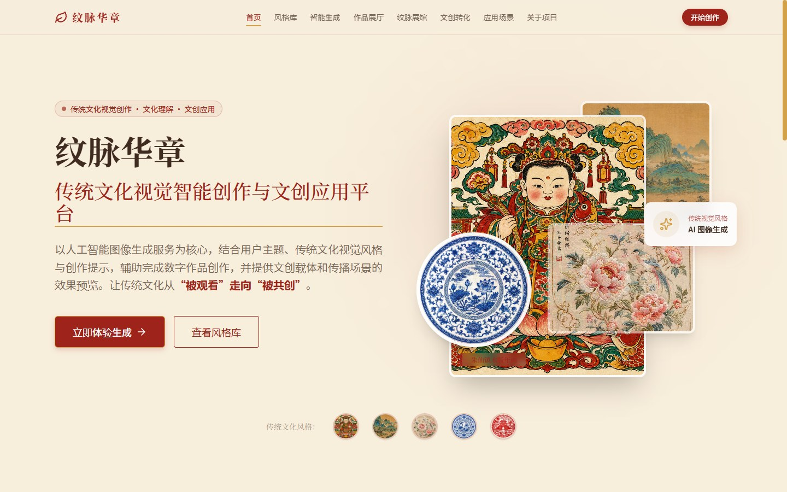

> **在线体验是静态前端演示**：可浏览内置作品、文化卡、三种互动、三维展馆与文创模板；实时 AI 生成、运行期作品保存与新作品互动构建需要在本机启动 FastAPI 后端。在线页面不提供密钥，也不运行云端或本地模型。

## 一个平台，五个环节

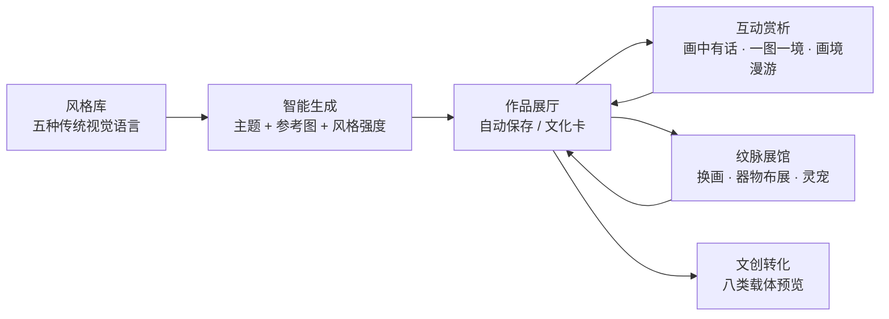

## VNext 本轮升级

- **导航第一项恢复为“首页”**：首页 → 风格库 → 智能生成 → 作品展厅 → 纹脉展馆 → 文创转化 → 应用场景 → 关于项目；桌面单行、移动端折叠菜单。首页内容暂按用户要求回退到上一版，后续再单独调整。
- **运行期作品闭环**：生成成功后自动保存原图、参考图、参数、文化卡与元数据；展厅按 `caseId` 拉取，新作品无需重启前端即可出现。
- **三种互动按作品自动构建**：画中有话（热点 + 解读）、一图一境（三折叙事）、画境漫游（本图深度资产）；作品、热点、章节、画境、文化卡与展馆挂画全部绑定同一个 `caseId`，不再按 `styleId` 猜作品。
- **任务状态持久化**：`queued → processing → ready / partial / failed` 落盘到 `backend/outputs/interactive_jobs.json`；后端重启不丢历史，失败可重试，已完成不会被重复覆盖。
- **深度能力降级**：本机深度模型不可用时改用本图亮度/中心权重/垂直梯度的近似深度，画境仍可打开，并明确标注“有限视差、近似深度”。
- **作品展厅重做**：作品图为主体，支持风格与来源筛选、最新优先、构建状态、三种互动入口、文创预览与进入展馆布展。
- **纹脉展馆控件分层**：默认只保留 探索模式 / 布展模式 / 视角；机位收进“视角”，昼夜收进“环境”，重置只在布展二级菜单，说明合并到“帮助”。
- **展馆观感与性能**：现有 GLB 上重做色调映射、曝光、阴影范围、重点照明与暖木/石材/铜/纸材质参数；限制 DPR、收敛阴影相机、页面隐藏时降频。
- **新作品进入展馆作品池**：图库按 `caseId` 读取后端作品池，新生成作品带“新生成”标记，可直接挂到画框；画框按图片真实比例 contain，不拉伸；布展经 localStorage 持久化。
- **灵宠模块可替换**：模型 URL、动画映射、缩放与朝向适配集中封装，后续换最终版 GLB 只改配置。

| 本轮真实验证 | 结果 |
|---|---|
| TypeScript / 前端测试 / 构建 | `tsc` 0 错误；44/44 测试通过；`vite build` 成功 |
| 运行期三案例（汴绣 / 朱仙镇 / 青花瓷） | 各自 `experienceId`、图片哈希、热点坐标、world slug 独立，`HOTSPOTS_DISTINCT=True` |
| 部分失败与恢复 | 移走画境资产 → `partial`；重建 → `queued` → `ready`（约 15.2 s） |
| 后端重启 | `/interactive-jobs` 仍返回 `ready`（attempts=2） |
| 展馆布展 | 作品池 8 件；可把新作品挂到 `FRAME_F2_003`；刷新后 localStorage 保留该 caseId |
| 浏览器 | 展厅、三种互动、展馆 canvas 无运行时异常 |

验证细节与过程脚本保存在本机 `.work/vnext-20261024/`（不随仓库分发）。

## 界面实拍

以下均为 **2026-10-24 在本机运行最新代码后的真实截图**，桌面 1440×900，移动端 390×844；不是 AI 生成的界面效果图。

### 创作入口

| 风格库 | 智能生成 |
|:---:|:---:|
| [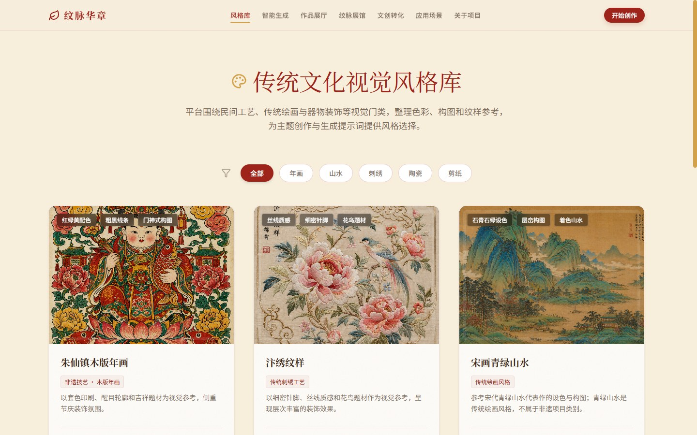](docs/screenshots/vnext/styles.jpg) | [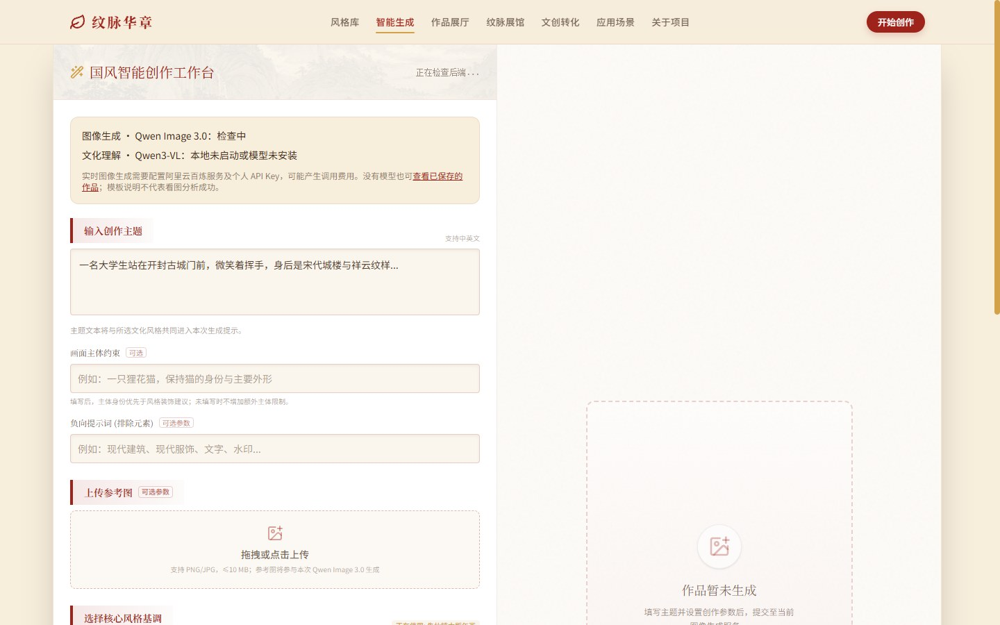](docs/screenshots/vnext/creator.jpg) |
| 五种风格统一取自 `styleLibrary`，每类一张正式图 | 主题、参考图、主体约束、风格强度与负向提示同屏 |

### 作品展厅与三种互动

| 作品展厅 | 画中有话 |
|:---:|:---:|
| [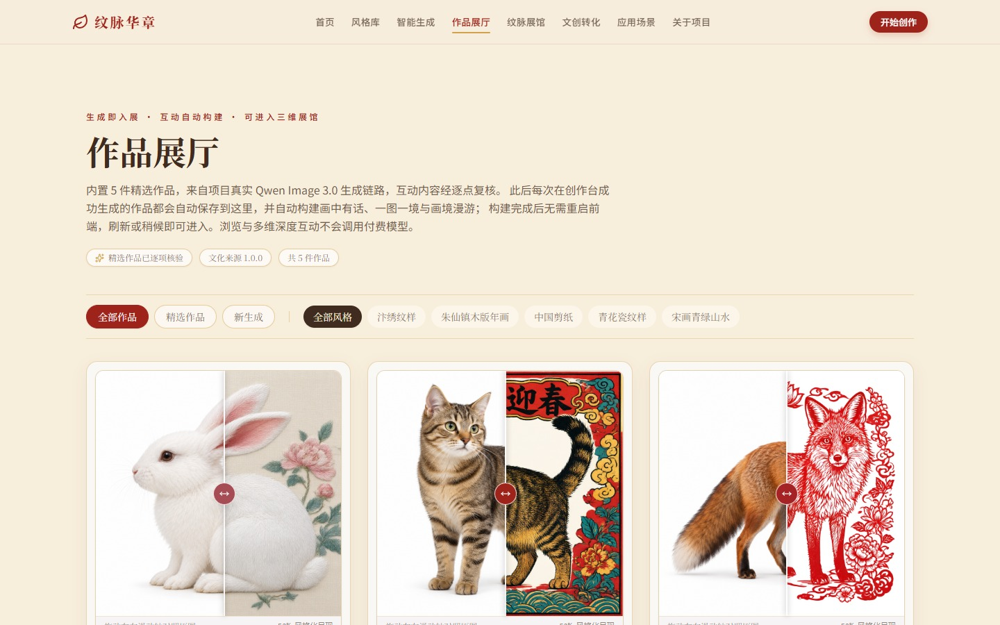](docs/screenshots/vnext/gallery.jpg) | [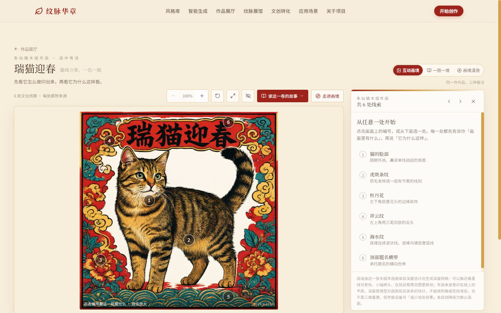](docs/screenshots/vnext/experience.jpg) |
| 按风格/来源筛选，最新优先，显示互动状态 | 热点缩放、局部观察、文化解读与来源 |

| 一图一境 | 画境漫游 |
|:---:|:---:|
| [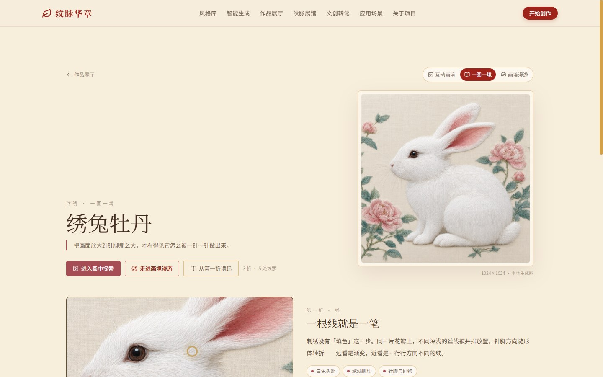](docs/screenshots/vnext/story.jpg) | [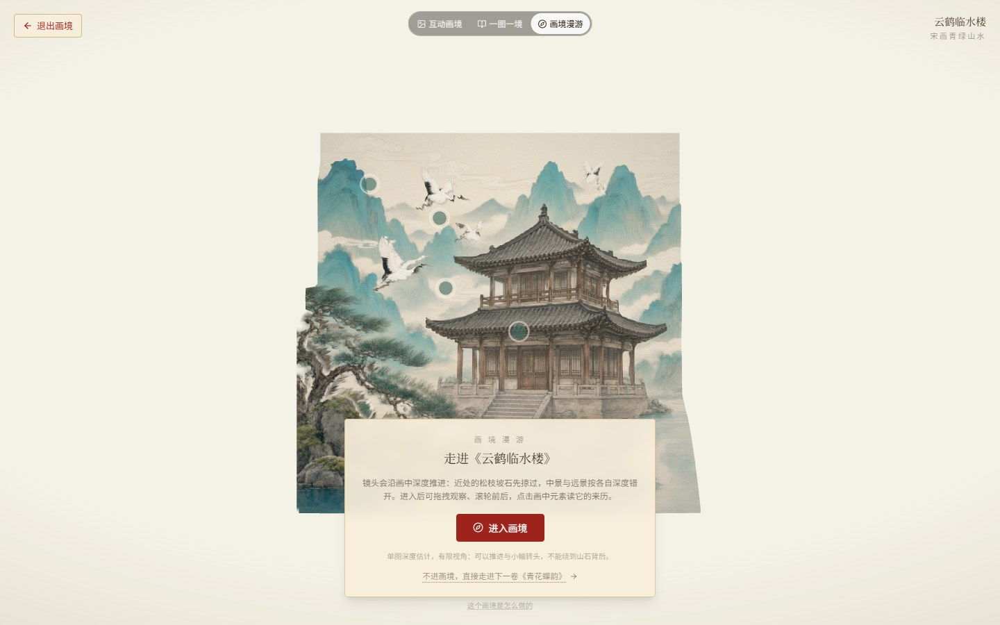](docs/screenshots/vnext/wander.jpg) |
| 三折章节随阅读切换焦点 | 单图深度网格，支持推进与有限转头 |

### 纹脉展馆

| 建筑外观 | 馆内空间 |
|:---:|:---:|
| [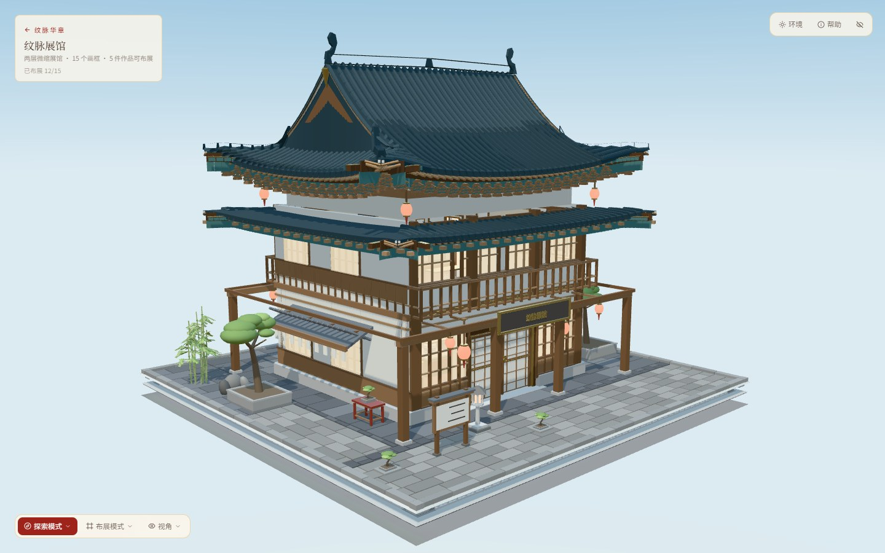](docs/screenshots/vnext/gallery-exterior.jpg) | [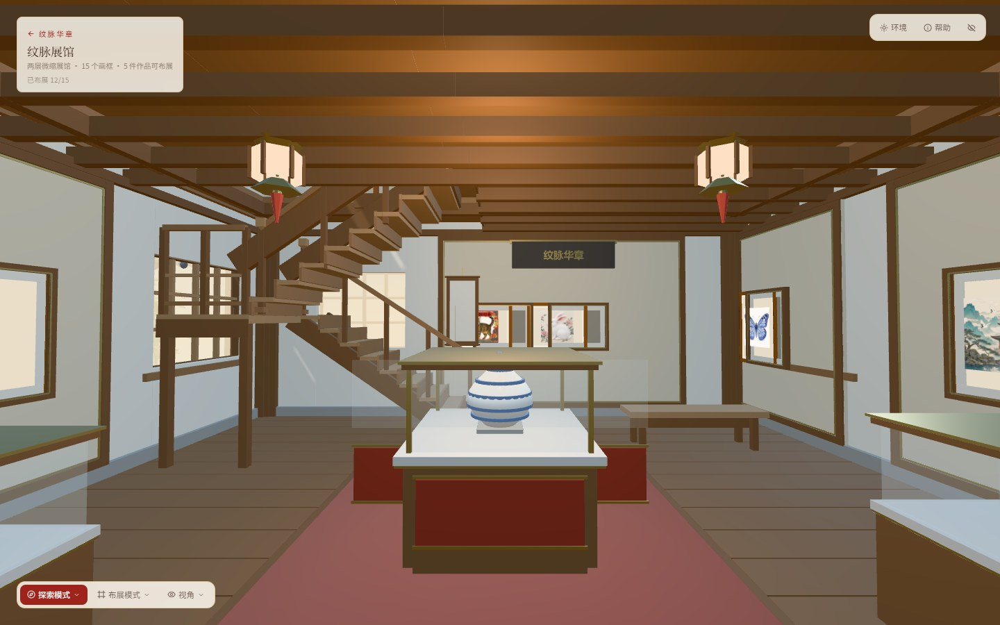](docs/screenshots/vnext/gallery-interior.jpg) |
| 中式屋顶、台基与檐下灯光 | 展墙、画框、展柜与可探索动线 |

[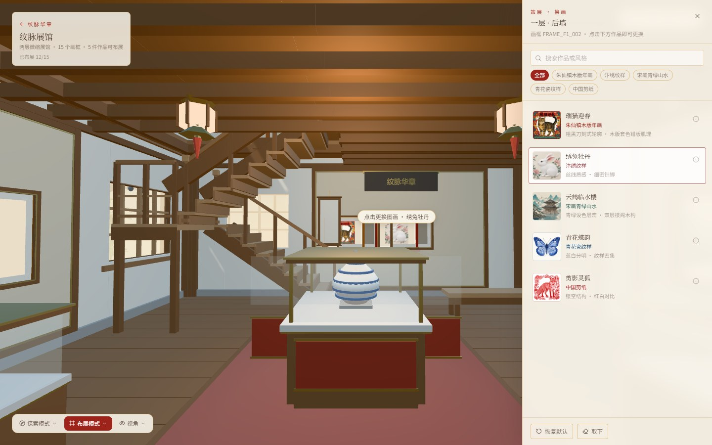](docs/screenshots/vnext/gallery-diy.jpg)

布展模式中点击画框打开作品池；支持更换、取下、恢复默认，以及 14 件非遗器物的摆放、吸附、旋转、缩放与持久化。灵宠“纹纹”保留第一/第三人称探索，模型接入已模块化。

### 文创与应用说明

| 文创转化 | 应用场景 |
|:---:|:---:|
| [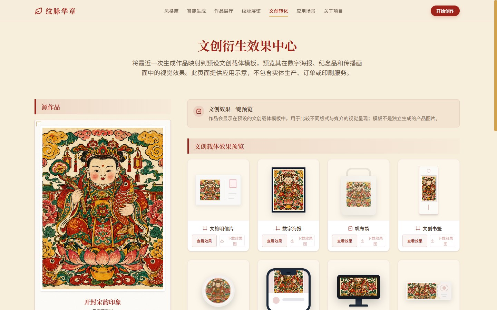](docs/screenshots/vnext/products.jpg) | [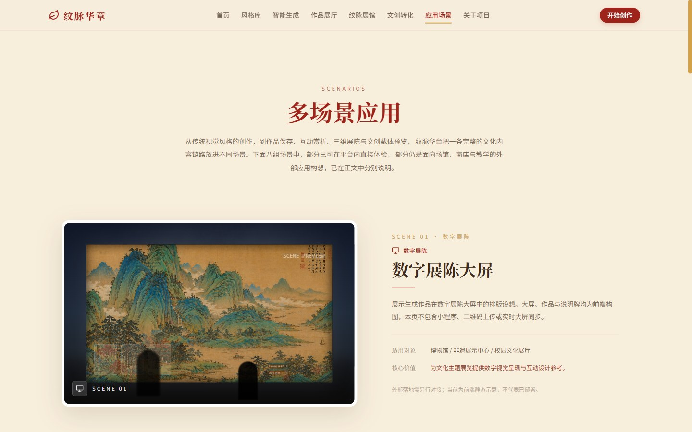](docs/screenshots/vnext/scenarios.jpg) |
| 八类载体，按比例预览并可导出 PNG | 已实现场景配真实截图；未部署场景明确标“应用构想” |

| 关于项目 | 移动端 |
|:---:|:---:|
| [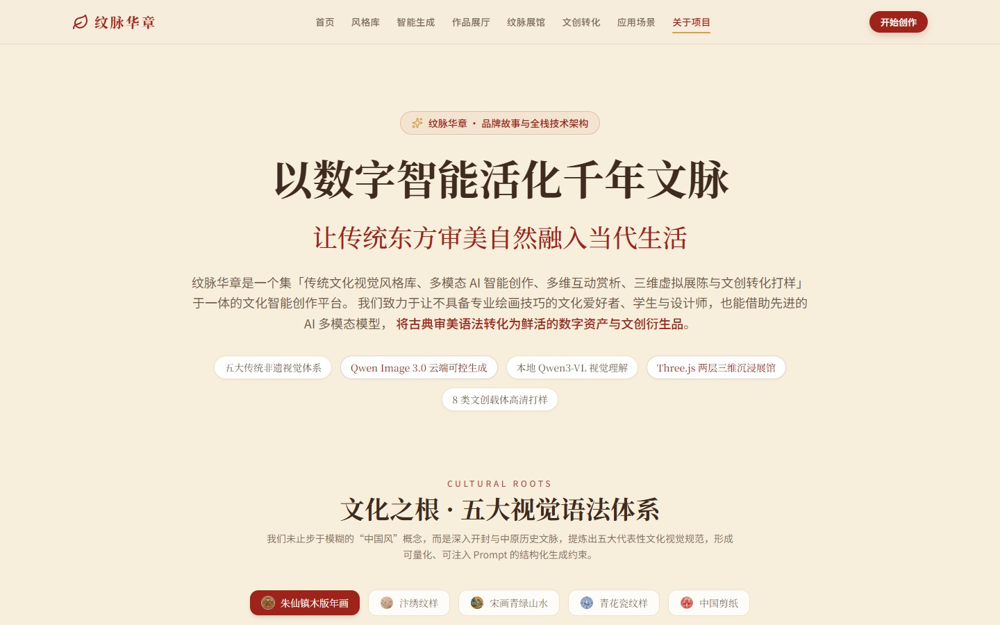](docs/screenshots/vnext/about.jpg) | [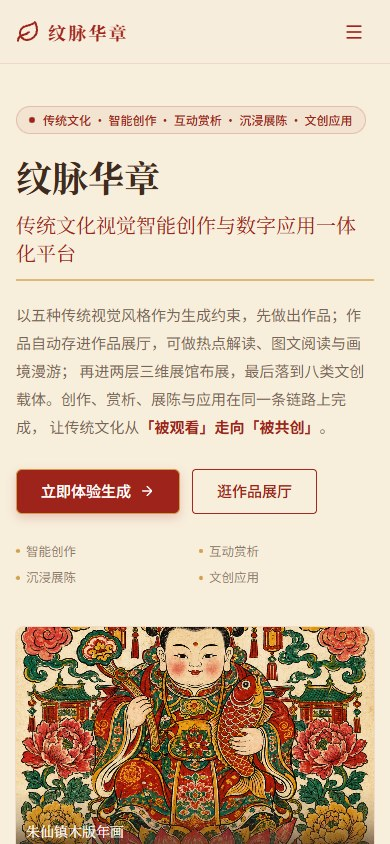](docs/screenshots/vnext/home-mobile.jpg) |
| 十项能力说明、架构简图与技术限制 | 折叠导航与响应式排版 |

## 自动互动流水线

一次成功生成的完整链路：

```text
/generate 成功
  → case_store 写入 docs/examples/<caseId>/
      generated.png · reference.png · culture_card.png · metadata.json
  → 返回 savedCase + interactiveJob
  → 后台线程执行 scripts/interactive/ingest_case.py --refresh <caseId>
      1. 深度估计（模型不可用时近似深度降级）
      2. 自动热点（approximate / pending）
      3. 三折叙事（沿用该风格知识包与来源编号）
      4. 画境资产 → frontend/public/interactive/<caseId>/world/
      5. experience.json + metadata.experienceId 回写
  → 任务状态落盘，展厅轮询 /cases 自动更新
  → 前端 /experience|story|wander/<caseId> 运行期读取该作品自己的数据
```

接口：

| 接口 | 用途 |
|---|---|
| `GET /cases` | 作品清单（含 interaction 状态、图片地址） |
| `GET /cases/{caseId}` | 单件作品 + 自己的 `experience.json` + 任务状态 |
| `POST /cases/{caseId}/interactions/rebuild` | 重新构建（仅运行期案例；内置精选受保护） |
| `GET /interactive-jobs` | 持久化任务状态：queued / processing / ready / partial / failed |

前端不依赖 Vite 重新编译来“假装实时”：作品列表、详情与体验都通过统一 Case Service 运行期获取；静态 Pages 仍使用随包内置的五件作品作为演示数据。

## 五件内置真实作品

五组案例随仓库提交，包含参考图、成图、文化卡与完整 `metadata.json`（SHA-256、参数、分析来源），离线可读。

| 风格 | 作品 | 参考 | 成图 | 文化卡 |
|---|---|---|---|---|
| 朱仙镇木版年画 | 瑞猫迎春 | [参考](docs/examples/zhuxianzhen/reference.png) | [成图](docs/examples/zhuxianzhen/generated.png) | [文化卡](docs/examples/zhuxianzhen/culture_card.png) |
| 汴绣纹样 | 绣兔牡丹 | [参考](docs/examples/bianxiu/reference.png) | [成图](docs/examples/bianxiu/generated.png) | [文化卡](docs/examples/bianxiu/culture_card.png) |
| 宋画青绿山水 | 云鹤临水楼 | [参考](docs/examples/songhua/reference.png) | [成图](docs/examples/songhua/generated.png) | [文化卡](docs/examples/songhua/culture_card.png) |
| 青花瓷纹样 | 青花蝶韵 | [参考](docs/examples/qinghua/reference.png) | [成图](docs/examples/qinghua/generated.png) | [文化卡](docs/examples/qinghua/culture_card.png) |
| 中国剪纸 | 剪影灵狐 | [参考](docs/examples/jianzhi/reference.png) | [成图](docs/examples/jianzhi/generated.png) | [文化卡](docs/examples/jianzhi/culture_card.png) |

参考图包含经授权用于本项目的 AI 图像，不是历史实物照片；来源与权限见 [案例来源](docs/examples/reference_sources.md)。年画猫输出保留了题字，说明负向文字约束未完全生效；仓库不为展示效果修饰模型输出。

## 技术架构

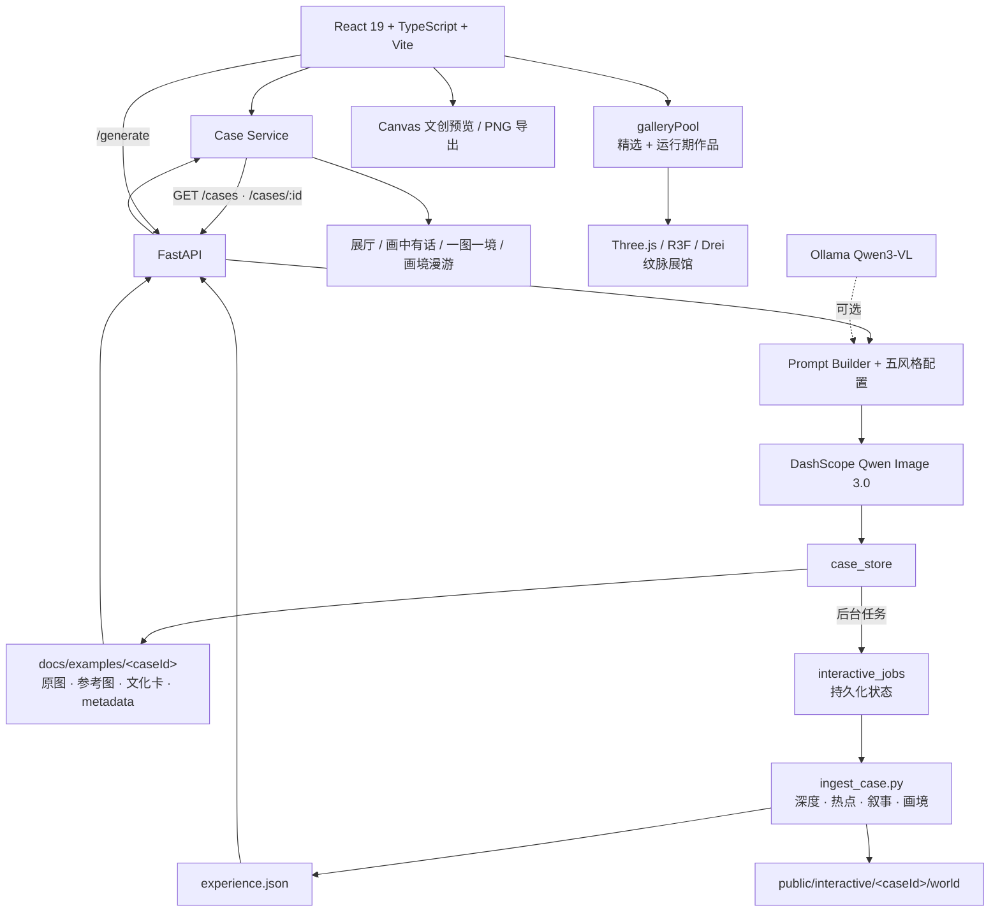

- 前端：React Router、Tailwind CSS、Motion、Zod、Zustand。
- 后端：FastAPI、Pydantic、Pillow；作品用本机文件保存，没有独立数据库。
- 展馆：预构建 GLB + React Three Fiber；布展与器物状态用 localStorage。
- 文化来源：`culture_knowledge/` 本地注册表，不声称在线检索或自动事实核查。

更多说明：[架构](docs/architecture.md) · [运行与故障处理](docs/running.md)

## 快速开始

需要 **Python 3.10+、Node.js 20.19+ / 22.12+、npm**；运行前端 TypeScript 测试建议 Node.js 22.18+ 或 24。首次安装依赖需要联网；实时文化理解可选安装 Ollama 模型。

### Windows 一键运行

```powershell
.\check_environment.cmd
.\setup_windows.cmd
# 首次安装后编辑 backend/.env，填写自己的百炼配置
.\start_windows.cmd
# 使用完毕
.\stop_windows.cmd
```

`setup_windows.cmd` 创建虚拟环境、安装前后端依赖并准备素材；`start_windows.cmd` 选择空闲端口并传递前后端地址；`stop_windows.cmd` 只关闭自身记录且启动时间匹配的进程，保留共享 Ollama。

### 手动启动

```powershell
# 后端（backend 目录）
.\venv\Scripts\python.exe -m uvicorn app:app --host 127.0.0.1 --port 8000

# 前端（frontend 目录）
npm ci
npm run dev
```

验证顺序：后端 `/health` → 后端 `/generate` → 前端 `npm run dev` → 浏览器。接口文档见运行中后端的 `/docs`。

### 配置

只在本地编辑 `backend/.env`，参照 [配置模板](backend/.env.example)。密钥不会进入前端或 Git。

```dotenv
GENERATION_PROVIDER=dashscope_qwen_image
ALLOW_MOCK_FALLBACK=false
DASHSCOPE_API_KEY=
DASHSCOPE_BASE_URL=
DASHSCOPE_IMAGE_MODEL=qwen-image-3.0
QWEN_VL_ENABLED=true
QWEN_VL_BASE_URL=http://127.0.0.1:11434
QWEN_VL_MODEL=qwen3-vl:4b-instruct-q4_K_M
# 新作品后台互动构建（默认开启）
AUTO_BUILD_INTERACTIVE=true
# 深度模型不可用时会自动降级为近似深度，画境仍可打开
```

没有生成密钥也可浏览内置作品、文化卡、三种互动、画境与三维展馆；实时生成与新作品互动构建需要本机后端。

## 项目目录

```text
wenmai-huazhang/
├─ frontend/                 React 应用、页面、互动与三维展馆
│  ├─ src/data/             风格库、案例、运行期体验与展馆作品池
│  ├─ src/features/         画中有话、一图一境、画境、展馆场景与器物
│  ├─ public/models/        运行时 GLB 模型
│  ├─ public/interactive/   已烘焙画境资产
│  └─ tests/                数据契约与几何测试
├─ backend/                 FastAPI、生成、案例保存、持久化任务
├─ culture_knowledge/       文化来源注册表
├─ docs/examples/           五件内置作品与元数据
├─ docs/screenshots/vnext/  本轮真实截图
├─ scripts/interactive/     互动与画境构建流水线
├─ .work/                   本地过程文件（不提交）
├─ setup_windows.cmd
├─ start_windows.cmd
└─ stop_windows.cmd
```

## 功能状态与限制

| 能力 | 状态 |
|---|---|
| 首页入口与导航、应用场景、关于项目 | 已实现（首页暂为回退版） |
| 智能生成（Qwen Image 3.0，文本/参考图） | 已实现，需本机配置与额度 |
| 生成后自动保存、作品展厅运行期刷新 | 已实现 |
| 画中有话 / 一图一境 / 画境漫游自动构建 | 已实现；热点为自动约定位，需人工复核 |
| 任务持久化、失败重试、部分完成 | 已实现 |
| 新作品进入展馆作品池、画框换画、布展持久化 | 已实现 |
| 14 件非遗器物布展、灵宠第一/第三人称 | 已实现；灵宠为可替换占位模型 |
| 展馆建筑重建 / Blender 重新建模 | 本轮未做，仅优化现有 GLB 的灯光、材质与控件 |
| 多用户账号、云端数据库、交易与实体生产 | 未实现 |

其他边界：

- 单图深度只描述前后关系，画境不能绕到主体背后；低性能设备会降级。
- 自动热点与自动文化解读标注为 approximate / AI 辅助，不冒充人工复核或文物认证。
- 文创图是模板效果预览，不是印刷生产文件。
- 三维场景与 11 MB 级 GLB 在低性能设备上可能加载较慢。
- GitHub Pages 只托管静态前端，不运行 FastAPI、生成服务或深度模型。

## 历史版本与许可

保留 [iCAN v1.0.0 视频与方案 Release](https://github.com/3331083641-prog/wenmai-huazhang/releases/tag/v1.0.0) 与历史提交；[历史文件索引](docs/history/README.md) 记录已移出发布目录的开发备份。

项目原创代码采用 [MIT](LICENSE)，保留既有 Apache-2.0 声明与 [第三方许可说明](THIRD_PARTY_NOTICES.md)。模型、云端服务与素材按各自条款使用，MIT 不重新授权这些内容。