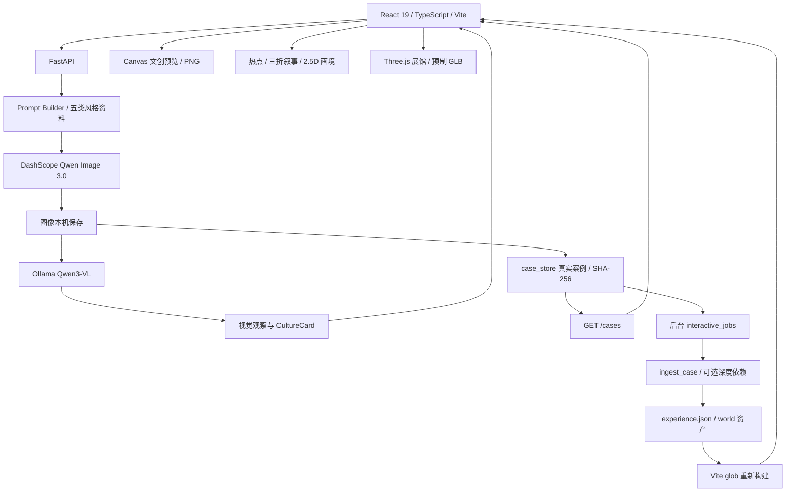

# 架构与接口

本说明以 `frontend/src/App.tsx`、`backend/app.py`、`provider_service.py`、`case_store.py`、`interactive_jobs.py` 与现有互动流水线为依据。

## 图像与文化说明

React 把主题、风格、参考图、负向提示、风格强度、构图、主体约束和用途提交至 `/generate`。Pydantic 校验输入，Prompt Builder 组织文化风格与用户约束，DashScope provider 提交文本及可选图片条件并取回图像。`styleStrength` 映射为提示词风格强调，不能解释成训练参数或独立风格模型权重。

图像落盘后，`services/vision_analysis.py` 将实际图片提交本地 Ollama Qwen3-VL，读取主体、主色、构图、视觉特征和文化解读。视觉服务不可用时保留成功生成图片，标记 `template_fallback`，模板不算真实看图结论。`/analyze-image` 提供参考图的尺寸、色彩等基础分析，与生成图的 Qwen3-VL 理解不同。

主路径使用个人百炼账号。后端保留其他 provider 实现及历史配置，但公开请求模型当前只接受 `dashscope_qwen_image` 或 `instantstyle`。默认不会把云端失败伪装为演示生成成功。

## 页面和展示方式

| 路由 | 功能 |
| --- | --- |
| `/`、`/styles`、`/about`、`/scenarios` | 首页、五类风格资料、项目介绍、应用场景 |
| `/creator` | 主题与参考图创作、参数、结果下载、文化说明 |
| `/gallery` | 五组精选真实案例与运行期案例 |
| `/products` | 8 类预设载体映射及 1600×1200 PNG 下载 |
| `/experience/:id` | 热点、文化来源、画面观察 |
| `/story/:id` | 三折叙事和章节定位 |
| `/wander/:id` | 单图深度驱动的 2.5D 画境，带静态降级 |
| `/heritage-gallery` | 预制 GLB 三维展馆、机位、漫游、布展与道具交互 |

本地使用 BrowserRouter。GitHub Pages 用 `VITE_STATIC_SHOWCASE=true` 切换 HashRouter，`VITE_PUBLIC_BASE=/wenmai-huazhang/` 定位静态资源。Pages 只运行浏览器代码，展示内置案例与已烘焙画境、展馆；实时生成提示回本机使用，不运行 FastAPI 或模型服务。

2.5D 画境把单张成图、估计深度、遮罩和抠像组合成有限视差空间，不恢复真实三维物体。前端检测 WebGL2、设备与帧率，必要时回落静态视差。三维展馆是独立预制场景（React Three Fiber / Drei / Three.js），具备相机和物件交互，不是任意图片自动生成三维建筑。

## 案例与后台互动构建

`case_store.py` 默认保存真实案例至 `docs/examples/<styleId>-<时间>-<请求标识>/`，包含 `generated.png`、可选 `reference.png`、`culture_card.png`、`metadata.json`。哈希和尺寸来自实际文件，演示产物默认不入库；内置五件案例受删除保护。`AUTO_SAVE_CASES=false` 可以关闭保存。

保存后 `interactive_jobs.py` 在后台线程执行 `scripts/interactive/ingest_case.py --refresh <case>`，不阻塞出图响应。流水线生成三折叙事、自动热点、`experience.json` 和画境资产，回写 `experienceId`。自动热点标为 approximate / pending，文化解读沿用风格知识与来源编号，需人工检查是否适配具体画面。

扩展依赖 NumPy、PyTorch、Transformers、Depth Anything V2 Small 权重，基础后端依赖没有完整包含。标准安装不保证后台画境构建成功，可用 `AUTO_BUILD_INTERACTIVE=false` 关闭；失败不撤销已生成图片和案例。任务在内存保存，默认超时 900 秒，重启不保留状态。

`/cases` 运行时读取新作品；`autoExperiences.ts` 用 Vite glob 将互动数据编译进前端。新增或删除互动清单后需重新构建或重启 dev；静态 Pages 需重新部署，刷新页面不够。既有五件精选案例和世界素材已保存，浏览时无需模型推理。

## 接口

| 接口 | 方法 | 用途 |
|---|---|---|
| `/health` | GET | provider、本地图像理解与素材状态 |
| `/generate` | POST | 实际生成、视觉分析、文化卡、保存及后台任务启动 |
| `/analyze-image` | POST | 参考图基础统计 |
| `/cases` | GET | 精选及运行期案例 |
| `/cases/{case_id}` | DELETE | 删除运行期案例，保护内置五件 |
| `/interactive-jobs` | GET | 当前进程的后台互动构建状态 |
| `/outputs/*`、`/style_refs/*`、`/examples/*` | GET | 本机生成图、风格素材和案例 |

生成字段：`theme`、`style`、`styleName`、`outputType`、`styleStrength`、`compositionMode`、`negativePrompt`、`subjectLock`、`uploadedImage`、`generationProvider`。校验规则以 `/docs` 为准。上传图片使用数据 URL，历史和最近作品使用浏览器 LocalStorage，持久案例在本机文件系统，没有独立数据库或多用户账号系统。

## 输出与限制

五组已保存案例原图为 1024×1024 PNG，文化卡 1080×1440 PNG；文创导出固定 1600×1200 PNG。载体包含明信片、海报、帆布袋、书签、杯垫、手机分享图、展陈屏与纪念票，属于预设模板效果，不是印刷生产文件或实体打样证明。

文化卡是辅助审美解读，不能据此认定 AI 图像是历史实物、馆藏或传统手工原作。实际测试与限制见 [工程审计](ENGINEERING_AUDIT_20261024.md)，环境与运行见 [运行说明](running.md)。
