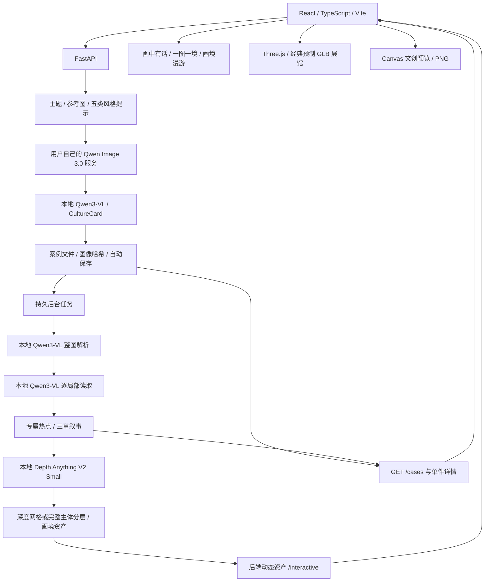

# 架构与接口

本文对应当前源码与 2026-10-25 的真实运行验证。

## 生成与保存

`backend/provider_service.py` 组织生成流程；`prompt_builder.py` 将主题、风格强度、构图、负向提示、主体和参考图转为请求。主路径使用用户自己的百炼账号与 `qwen-image-3.0`。`styleStrength` 是提示强调程度，不是自训练权重。

`services/vision_analysis.py` 将真实成图传给本机 Ollama Qwen3-VL 构建文化卡；失败时保留成图，文化卡明确标记模板兜底。参考图的 `/analyze-image` 另做尺寸、色彩等基础统计。

`case_store.py` 保存参考图、成图、文化卡、参数、来源和哈希。五件精选受保护，新作品按独立 `caseId` 管理。没有独立数据库、多用户账号或云端作品同步服务。

## 每件新图的自动互动

`interactive_jobs.py` 在保存后启动后台工作进程，状态原子写入 `backend/outputs/interactive_jobs.json`。同件作品的活动任务不会重复并发写入。非零退出、超时和中断明确失败，不以遗留文件冒充本次成功。

`services/interaction_plan.py` 只允许本机 Ollama `/api/chat` 与本地 `qwen3-vl:*`。模型先读本图，再分别读取整图与实际热点裁切，生成局部观察、标题和审美解读，最后依据这些观察重新写三章叙事。代码校验结构、坐标、引用和重复，不人工补写作品内容。缓存绑定成图哈希、风格上下文、提示版本与模型。

`scripts/interactive/depth_estimation.py` 读取固定版本、经 SHA-256 校验的本地 Depth Anything V2 Small。后台不下载权重。深度缓存绑定输入图像及模型 revision，不按同名文件复用旧深度。它只估计相对远近，不撰写文化解读。

`build_painting_world.py` 从同图生成贴图、深度、遮罩、前景及清单。山水采用平滑深度网格；确认白底的平面主体采用完整分层，避免细腿、长喙被网格拉扯。原图仍保留。微动类别依据本图 Qwen 解析，不把所有蓝纹都当水面。自动位置不冒充人工复核，2.5D 不恢复物体背面。

前端 Case Service 回读最新状态，运行期记录优先于构建时快照。画境从后端动态获取资产，不依赖 Vite 重启；资产带构建版本，避免重建后残留旧贴图。`Vary: Origin` 防止普通图片缓存影响后续 WebGL 跨源纹理。取景按视口与图片比例计算，点击坐标统一为图片左上原点。

## 页面与数据

| 路由 | 功能 |
|---|---|
| `/`、`/styles` | 首页、五类风格 |
| `/creator`、`/gallery` | 创作、自动保存、筛选 |
| `/experience/:id` | 独立作品的文化热点 |
| `/story/:id` | 同一作品的三章阅读 |
| `/wander/:id` | 同图有限视角 2.5D 画境 |
| `/heritage-gallery` | 经典展馆、机位、换画、器物及灵宠 |
| `/products` | 八类载体预览与 PNG 导出 |
| `/scenarios`、`/about` | 六组场景、六大动态能力矩阵 |

三维展馆使用 React Three Fiber / Drei / Three.js 与预制 Blender / GLB，不是图片自动重建建筑。取消的新馆和双建筑切换不参与正式版。布展、器物及部分创作偏好保存在浏览器 LocalStorage。

## 接口

| 接口 | 方法 | 用途 |
|---|---|---|
| `/health` | GET | 生成配置、本地视觉服务与素材状态 |
| `/generate` | POST | 生图、文化卡、自动保存并启动后台互动 |
| `/analyze-image` | POST | 参考图基础统计 |
| `/cases`、`/cases/{caseId}` | GET | 列表、最新状态及本件互动 |
| `/cases/{caseId}/interactions/rebuild` | POST | 重试运行期作品，保护五件精选 |
| `/interactive-jobs` | GET | 持久任务状态 |
| `/cases/{caseId}` | DELETE | 删除运行期作品及资产 |
| `/examples/*`、`/interactive/*` | GET | 案例和动态画境资产 |

本地使用 BrowserRouter。GitHub Pages 使用 HashRouter 与仓库子路径，只展示已打包作品，不连接访问者本地后端，不执行生成或模型推理。新增作品需重新构建部署。

文化卡用于辅助赏析，不核验历史事实。模型解读和自动定位仍可能偏差。文创输出是 1600×1200 PNG 预览，文化卡为 1080×1440 PNG，不是完整印刷生产文件或实物打样证明。参见 [运行说明](running.md)、[模型交付](../models/README.md)。
