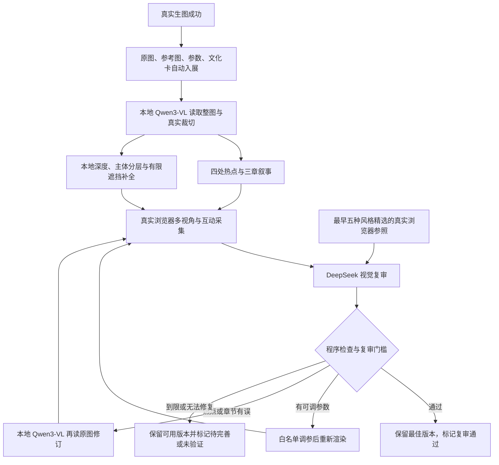

# 本图互动的自动视觉复审与优化

本地 Qwen3-VL 负责读图、热点、章节及语义修订；Depth Anything V2 Small 负责相对深度。DeepSeek 官方视觉 API 查看实际原图、浏览器画境和最早五件精选参照，提出问题及有限参数建议。程序决定是否采纳、重建或回滚，不执行模型返回的代码。

## 固定流程



每件默认最多三轮云端复审，达到目标提前结束。原图只生成一次，调参不重新调用生图服务。没有无限重试或保证任意图片完美的模式。

## 给模型的完整要求

正式要求保存在 [review_policy.json](../../scripts/interactive/review_policy.json)，版本与哈希写入每件报告。覆盖原像素保真、主体完整、细肢与羽丝、遮挡连续、前后视差、合理运动、热点和文字依据，以及严禁臆造历史事实或恢复真实背面。

参照是项目最早五件作品：年画瑞猫、汴绣兔、青绿楼阁、青花蝶、剪纸狐。程序用同一浏览器、同一视口重新采集五件参照；每次复审发送匹配风格的三个视角及其他四种风格的侧视，同时附本件原图和当前真实截图。参照本身不被视为完美真值，也不会覆盖它们的原始资产。

目标评分为五维加权 90 分，保真至少 90、遮挡至少 88，无 major/blocker，且浏览器程序检查必须通过。权重、门槛和参数范围均在策略文件中。评分属于模型主观判断，不能称作准确率、性能指标或人工验收。

DeepSeek 只能提出最多四个白名单参数，包括景深振幅、取景边距、视角、雾气/水纹/枝叶强度、主体相对起伏与纸面微动。未知字段、越界、NaN、布尔伪数字均拒绝；不能改路径、原图、密钥或执行任意脚本。

出现文字事实或章节问题时，DeepSeek 的反馈作为未核验的批评交给本地 Qwen3-VL；后者必须重新读取实际图片后写作。热点问题则由本地 Qwen3-VL 输出独立 `point_2d` 坐标，再读新裁切，重建属于本件的资产。内容始终来自本图的本地模型处理。

## 画境处理与边界

- 白底主体保留完整轮廓和本地模型内部相对深度；原生分辨率 alpha 与数学去白边减少双重白色合成造成的光晕。
- 默认保留白色身体；剪纸另保留内部白孔，采用浅层纸面阴影与有限纸面微动。它不等于有骨骼的动物行走动画。
- 有限前景移出区域使用 OpenCV Telea 作像素补全，并调整背景深度避免遮挡缓冲把前景剪掉。补全属于推断，不能恢复遮挡处真相；大区域、连到边缘的遮挡不宣称有效补全。
- 后景只由纸面边缘颜色生成延展，不再把整张主体模糊复制到后面造成重影。
- 连通山石触及局部搜索窗口边界时拒绝硬裁，保留连续深度网格，避免直边抠层在侧视露出接缝。
- 画境支持有限推进、转头、热点点击；程序与模型都不能把它描述为完整三维重建。

## 安装与配置

先按 [安装运行](../running.md) 准备项目与本地模型，在项目根目录安装可选深度及复审依赖：

```powershell
.\backend\venv\Scripts\python.exe -m pip install -r backend/requirements-interactive.txt
.\backend\venv\Scripts\python.exe -m pip install -r backend/requirements-review.txt
.\backend\venv\Scripts\python.exe scripts/setup_interactive_models.py --check
```

Windows 默认使用本机 Microsoft Edge 的临时配置。没有 Edge 时，可显式在 D 盘安装 Playwright Chromium：

```powershell
$env:PLAYWRIGHT_BROWSERS_PATH='D:\wenmai-huazhang\.cache\ms-playwright'
.\backend\venv\Scripts\python.exe -m playwright install chromium
# 在 backend/.env 中同时配置以上浏览器缓存目录与 WENMAI_REVIEW_BROWSER_CHANNEL=chromium
```

密钥只填本机 `backend/.env`，见 [官方 API 配置](../configuration/DEEPSEEK_OFFICIAL.md)。官方模型 ID 为 `deepseek-flash`。设置 `DEEPSEEK_REVIEW_ENABLED=true` 启用，`false` 保留纯本地互动路径。重启后端加载新配置；`/health` 只检查配置，不发起收费请求，也不代表质量通过。

默认每件最多 3 次请求、单次最多 4096 输出 tokens、HTTP 超时 180 秒，本机每日自动复审最多 24 次（包含失败 HTTP 尝试）。环境变量为 `DEEPSEEK_MAX_REVIEW_CALLS`、`DEEPSEEK_MAX_TOKENS`、`DEEPSEEK_TIMEOUT_SECONDS`、`DEEPSEEK_DAILY_REVIEW_LIMIT`。本机进程间复审锁串行运行浏览器与复审任务，避免多个后台任务争用；不会阻塞已经成功的生图响应。

实际费用按官方账单，报告保存实际 token 用量；上限不代表已花费金额。原五件参照与同一输入的有效评价有缓存；图片、代码、策略、资产或体验文字变化会使缓存失效。

## 如何运行与核查

正常创作无需手动执行命令：成功出图自动保存并启动后台。已有运行期作品可通过展厅原有“重新构建互动”入口触发。也可在项目根目录显式复审已有作品（可能产生费用）：

```powershell
.\backend\venv\Scripts\python.exe scripts/interactive/world_quality.py --case 你的运行期案例ID --style qinghua
```

截图采集器只访问本机预览，视口 1440×1000、DPR 1；新作默认采集正面、左右、推进、动态前后、热点点击及两种图文页面。记录画境身份、图像/清单/截图哈希、WebGL 状态、真实点击和像素变化。动态像素差异是测量，不代表运动一定合理；安全静态作品不因缺少运动被程序判失败。

后台原始截图、世界/案例快照、参照与预算账本保存在忽略目录 `.cache/world-reviews/`、`.cache/world-review-references/`、`.cache/world-review-backups/`、`.cache/world-review-daily-budget.json`。它们不包含 API Key。单件 `docs/examples/<case>/quality-review.json` 保存结构化评价和过程，metadata 的 `qualityReview` 独立于三个互动资产的就绪状态。

`approved` 表示本轮满足策略与程序门槛；`needs_review` 表示仍有待完善项；`unverified` 表示接口、依赖或采集未完成；`disabled` 表示未启用云端复审。接口出错、到限或评分退步时，不将其写成通过，不丢失生成作品。回滚时案例文字、图层资产和清单来自同一快照。
