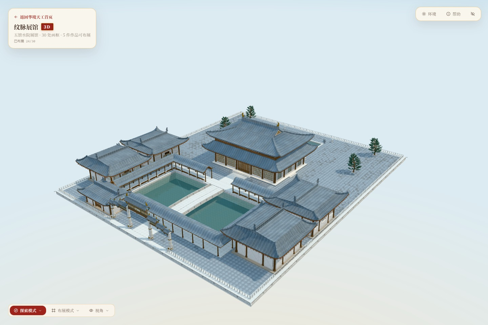
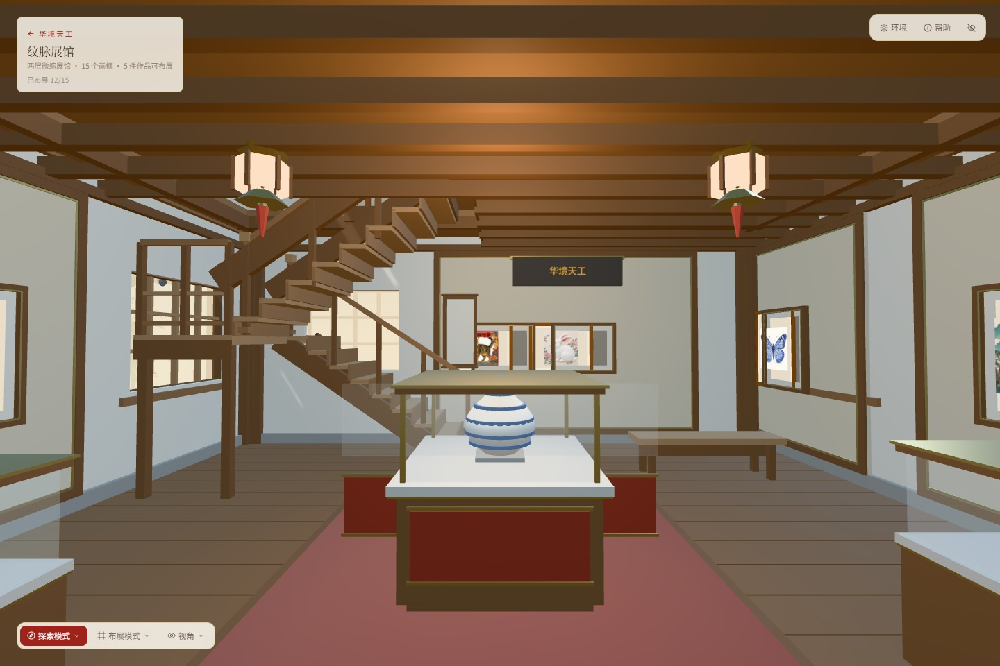
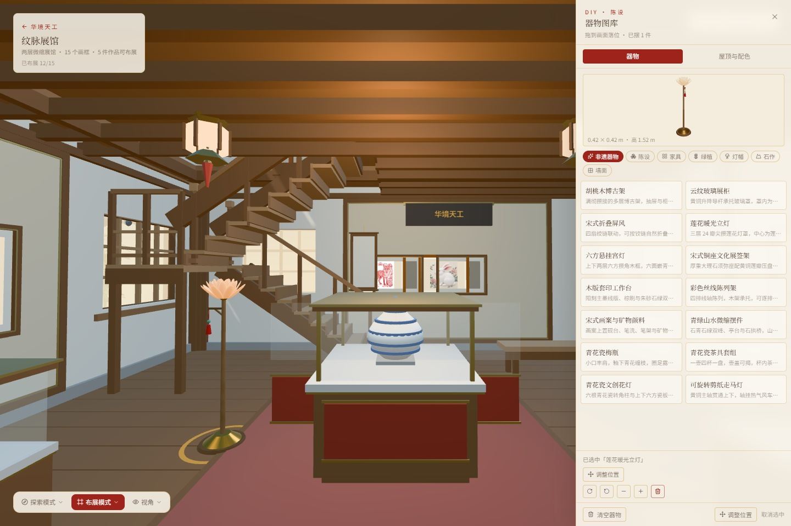

# 五馆水院 v15 · 主项目集成

五馆水院 v15 是 `/heritage-gallery` 当前使用的预制展馆。首页、关于项目和应用场景引用同一展馆的实拍预览。[查看当前界面截图](screenshots/current/README.md)。

主项目在 2026 年 11 月 14 日集成此模型，11 月 26 日恢复并形成 [056cec6 运行基准](https://github.com/3331083641-prog/wenmai-huazhang/commit/056cec6ffa86ea7411eac0136650a1cc0d0760f6)。11 月 28 日曾切换到国赛 v5 双层展馆，随后恢复五馆水院。此前验收采用的原始 v15 图像和代码见 [5268531](https://github.com/3331083641-prog/wenmai-huazhang/commit/52685310061a5c5989e01cca9255b2a6e3b8d27d)。

## 模型与加载

原始 GLB 360,051,900 字节，62 个网格，2,589,029 个三角面。原始 SHA-256：`084cfdb1fceb831addd880c0940248ae9626e0be357b51f0b452583a7fc183f3`。

`frontend/public/models/pavilion-v15/model.json` 描述 5 个独立 gzip 分包，总计 106,569,638 字节。使用 `.bin` 避免静态服务器根据 `.gz` 扩展名自动解压。浏览器依次下载、解压、校验每包 SHA-256 后还原原始 GLB。未简化几何或贴图。需要 HTTPS 或 localhost，以及支持 DecompressionStream 的现代浏览器。重新打包：`python scripts/pack-pavilion.py <已验收的模型.glb>`。

模型自带静态水面被动态反射水面替代；材质按 D:\Design 预览的 AO、玻璃与松针设置显示。项目天空和昼夜环境不替换，雾距和阴影范围按大院尺度调整。按最新反馈追加 14 盏暖色室内补光，分布于主殿、五馆展台与二层回廊，白天也保持开启；保留烘焙 AO 的结构层次。30 个换画锚点的位置、旋转来自真实 GLB 节点。

## 交互

- 左下角“视角”：第三人称环绕、电影、第一人称漫游，保留室内外机位。
- 第一人称：按住拖动环顾，WASD / 方向键行走，Shift 疾行，空格跳跃。
- 主殿和五馆门默认关闭，近距离出现点击开关提示，也可按 E；门扇摆动遇到玩家会退回。
- 澄怀轩、素肌堂沿实际折返楼梯上二层。静态网格分格碰撞及楼梯支撑公式与独立展馆相同。
- 前后水池可游动、下沉，空格上浮，C/Ctrl 下潜，岸边按空格向岸移动可上岸。
- DIY 保留器物库、台面与梁下吸附、地面落位、屋顶配色；地面落位按真实模型检查，拒绝无承载面的落点。

## v15 基准验收

后端 `/health` HTTP 200；`/generate` 空请求 HTTP 422（请求校验检查，未调用付费生图）。TypeScript 校验、生产构建通过；现有 52 项前端测试通过。

真实浏览器 69 项检查通过，覆盖六处门、主殿墙体、跳跃落地、前后池游泳/下潜/上岸、两馆上下楼路径、30 画框、原天空、DIY 面板、390 像素无横向溢出与无控制台错误。DIY 实际点击落位、黄昏切换另行复验。该检查证明已测路线，不是任意位置零缺陷证明。

## 2026 年 11 月 26 日恢复核验

本地浏览器收到清单、五个模型分包和匾额资源的 HTTP 200 响应，渲染场景识别到 62 个网格、30 处画框和「华境天工」匾额。已复验一层与二层机位，以及主殿关门时阻挡行走、点击开门后可走入。

首次模型下载约 101.6 MiB，浏览器需支持 WebGL 与分包解压。当前运行截图见下方及 [界面截图索引](screenshots/current/README.md)。

