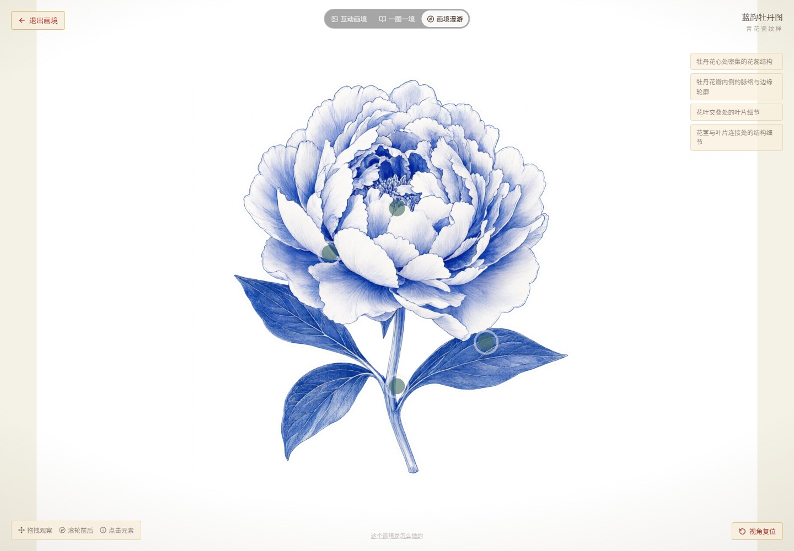
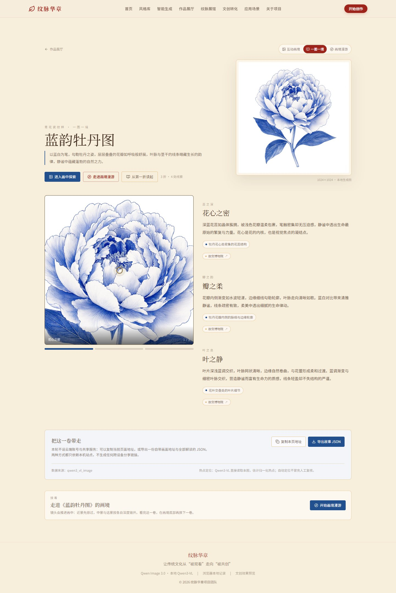
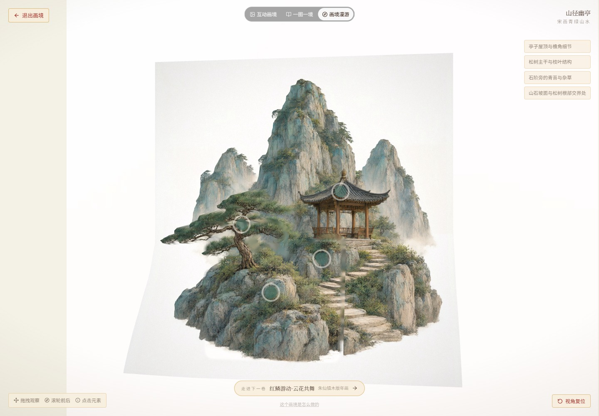

# DeepSeek 官方接入与自动画境复验

采集日期：2026-10-25。此页区分“自动流程跑通”和“画境质量达标”。**官方接口与新图全程已跑通；本轮不能证明接入后能稳定达到最早五件作品的效果，更不能宣称完美。**

## 真实端到端结果

新增案例 [青花牡丹](../../examples/qinghua-20261025-133153-2d80/metadata.json) 复用此前白底牡丹 AI 参考图，改用青花风格。只额外调用了一次真实 Qwen Image 3.0 生图；没有为调参反复生成原图。

1. `POST /generate` 返回 HTTP 200、`success=true`、`autoSave.saved=true`，已产生独立 `caseId`，后台状态为 `queued`。
2. 本地 `qwen3-vl:4b-instruct-q4_K_M` 读取本件成图及四处真实裁切，生成四处热点、三章叙事。
3. 本地 Depth Anything V2 Small 与代码生成本件深度、图层与画境；浏览器截图提交官方 `deepseek-flash` 复审，最多三轮。
4. 最终任务为 `ready`，三个资产阶段均为真；三个页面能实际打开。独立质量结论为 `needs_review`，没有冒充通过。

[生成响应、状态、源图绑定、评分履历与截图哈希](results.json) · [本件完整复审记录](../../examples/qinghua-20261025-133153-2d80/quality-review.json) · [固定工作流](../../interactive/DEEPSEEK_REVIEW_WORKFLOW.md)

| 本件真实画境 | 同件三章叙事 |
|:---:|:---:|
|  |  |

## 五风格复审，没有预先认定提高

使用原五件精选的同规格浏览器截图作参照，每轮实际发送目标原图和当前截图。下表是修复白边、热点可见性及遮挡问题后的五件既有新作复审，数值为模型主观五维加权分，不是准确率。存在 major/blocker 的候选不被选为最终版本。

| 案例 | 各轮主观分数 | 本批结论 |
|---|---|---|
| 青绿山亭 | 74.7 → 87.4 → 85.5 | 待完善；侧视接缝不能靠参数根治 |
| 青花丹顶鹤 | 86.95 → 87.5 → 86.95 | 待完善；内部层次与动态不足 |
| 剪纸骏马 | 78.5 | 本地热点修订未过校验，未完成复审 |
| 年画金鱼 | 84.45 → 83.9 | 本地热点修订未过校验，未完成复审 |
| 汴绣牡丹 | 84.2 → 83.4 → 83.4 | 待完善；内部起伏不足 |

早期某批金鱼、牡丹曾达到该次门槛，之后资产修复和重新复验未复现；不沿用早期“通过”作为当前结论。自动回滚保留可用版本，不用分数上升掩盖严重缺陷。

## 根据实际问题修复代码

- 热点绘制顺序修正，避免被透明前景盖住；新作取景留安全边距。
- 白底主体采用原生分辨率透明度与数学去白边；剪纸保留内部镂空，完整主体可使用本地相对深度形成浅浮雕。
- 取消整幅主体的模糊背景复制；小面积遮挡补全仅为本图像素推断。
- 复现并修复山水被局部窗口裁出垂直接缝的问题：连通主体触及搜索边界时拒绝硬裁，保留连续深度网格。回归测试先失败后通过。

| 修复前的真实侧视接缝 | 修复后的真实侧视 |
|:---:|:---:|
|  |  |

此处是两次真实运行的截图对照，未拼接为一张界面。修复后浏览器检查通过；追加一次云端评价遇到 `ReviewError`，因此本件最新云端状态为 `unverified`，没有给出修复后的通过分数。

## 工程与浏览器验证

- 后端与流水线单元测试：108 项通过；离线测试不使用付费接口。
- 前端：52 项测试、TypeScript、普通构建与 GitHub Pages 配置构建通过；构建仍提示现有 JS 包较大。
- Windows 启动器：15 项进程身份与进程树回归检查通过。本轮服务通过可跟踪会话启动，未重复执行完整一键启停；服务身份已记录供原停止脚本识别。
- 原五件参照均经实际浏览器采集并通过检查，原图、原有画境资产与经典展馆没有重建。
- 最终青花牡丹、修复后山水：画境身份、清单哈希、非空帧、WebGL、热点可见与点击、相机变化、视差检查通过；动态图像素变化单独保存，不等于动作合理性证明。
- 六件本轮案例的成图 SHA-256 与本地解析、画境来源全部一致。

截图使用真实 Edge / Playwright，视口 1440×1000、DPR 1；图文页面为全页截图。共保留八张精选截图，来源与 SHA-256 见 `results.json`。它们均非 AI 界面效果图。

## 费用、限制与剩余问题

本次自动复审账本记录 29 次请求尝试，包含此前试验、五风格复验、山水修复后一次请求及新图三轮；另有一次官方连通性和两件早期基线请求。实际 tokens 保存在报告，不据此推算账单金额。公开默认每日上限 24，本机本次有限验收设为 32，当日账本剩余 3 次。此为项目自己的请求预算，不是平台余额。

官方真实图像输入成功不等于每次回复都满足结构校验。两件本地热点修订失败、一次云端评价未完成均保留失败状态，没有自动无限重试。完整截图与案例快照留在本机忽略缓存，公开案例报告中的 `.cache/` 路径是历史证据位置，不随源码上传；精选截图已在本目录公开。

仍需改进：复杂内容的自动分层、花瓣/羽毛的内部相对起伏、细线保真和热点精确定位。当前没有恢复真实背面或骨骼动画。DeepSeek 能发现问题并受限调参，本轮证据不足以证明它能自动解决所有几何和语义问题。
