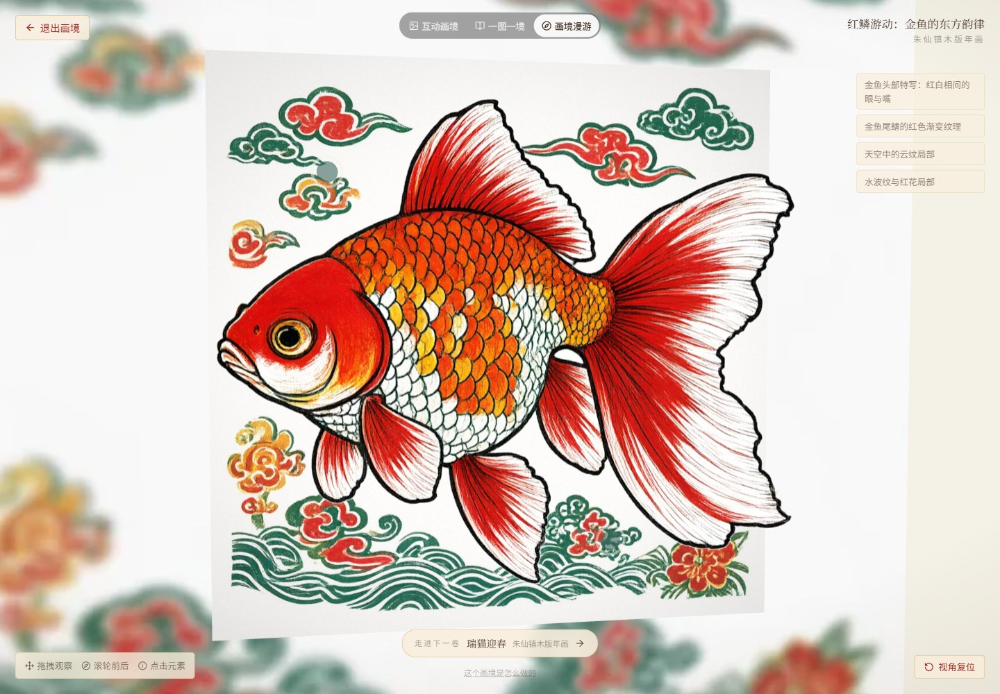
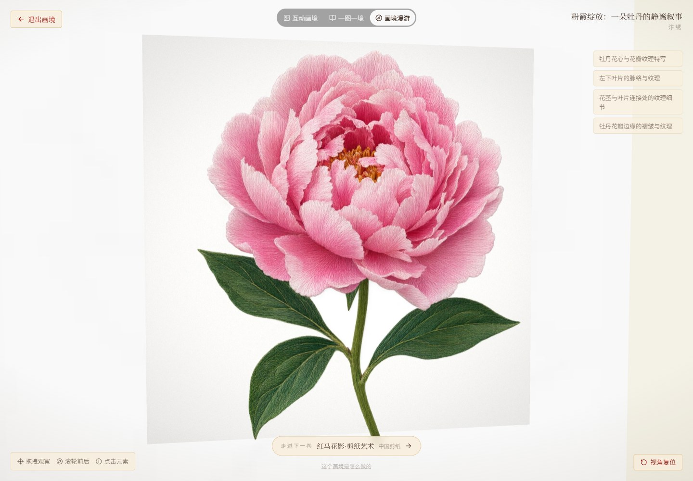
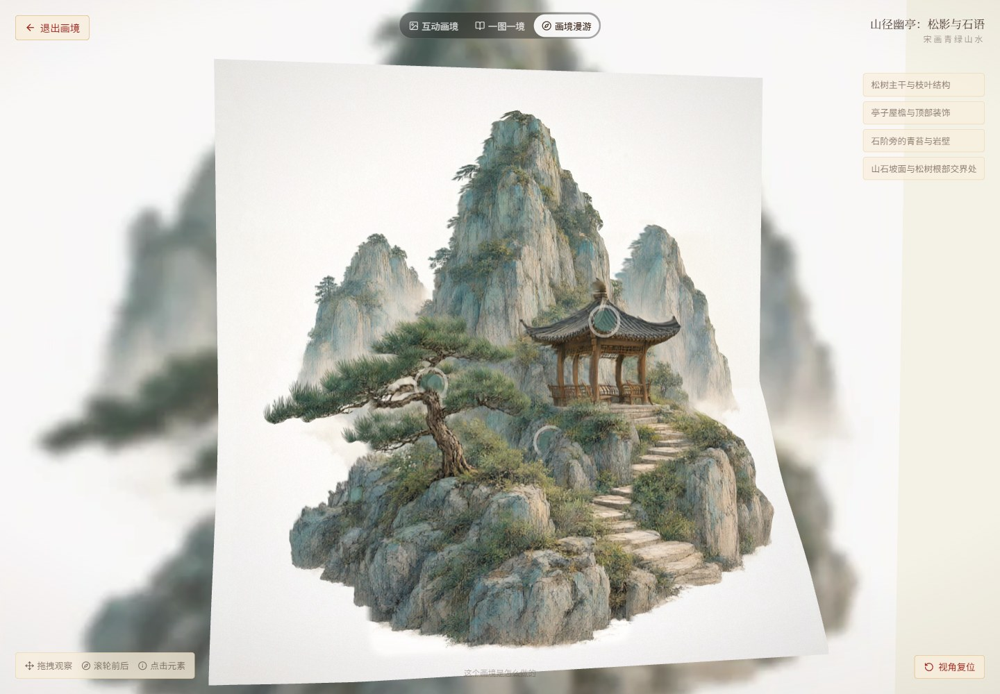
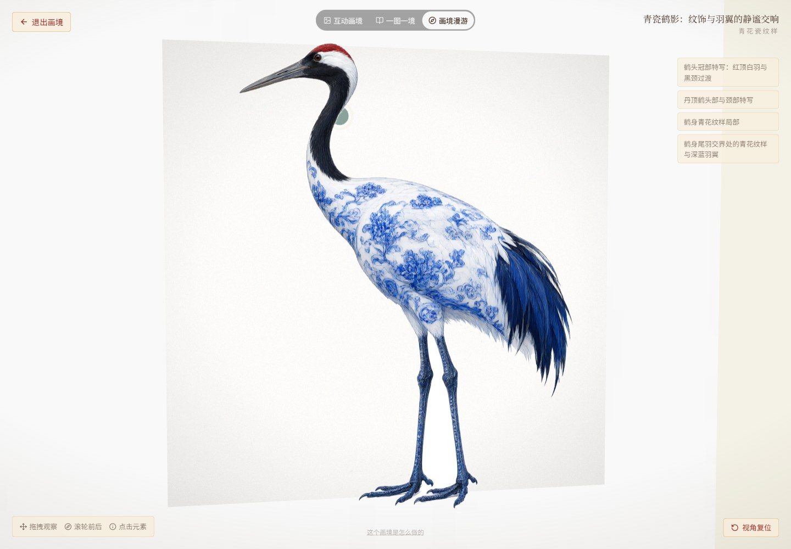
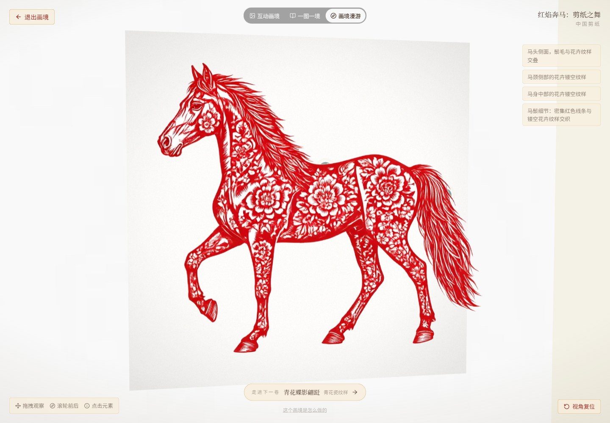

# 五种白底参考图的真实验证

采集日期：2026-10-25。五次真实 Qwen Image 3.0 图生图调用，每次使用不同参考图；无自动付费重试。此前另有一次真实青花蝶图生成。

参考输入由用户要求的内置 imagegen 工具生成，白底素材不是实物照片。互动内容只由本地 Qwen3-VL 读取整图与实际局部后产生；深度由本地 Depth Anything V2 Small 估计，图层及交互配置由代码构建。没有人工代写作品热点、章节或深度。

五件作品均自动保存；最终各有四处热点、三章叙事与独立画境。浏览器逐件打开三种体验，并进行画境转头、热点点击和视角复位。实际检查均未发生静态降级或页面运行时异常。

[机器可读结果与图像/模型哈希](results.json) · [流水线](../../interactive/NEW_CASE_PIPELINE.md) · [模型交付](../../../models/README.md)

| 风格 | 实际参考输入 | 真实生成结果 | 画境侧视截图 |
|---|---|---|---|
| zhuxianzhen · 红鳞游动：金鱼的东方韵律 | [参考图](../../examples/zhuxianzhen-20261025-010746-595e/reference.png) | [成图](../../examples/zhuxianzhen-20261025-010746-595e/generated.png) · [文化卡](../../examples/zhuxianzhen-20261025-010746-595e/culture_card.png) | [真实画境](white-reference/zhuxianzhen-world-side.jpg) |
| bianxiu · 粉霞绽放：一朵牡丹的静谧叙事 | [参考图](../../examples/bianxiu-20261025-010853-f7cd/reference.png) | [成图](../../examples/bianxiu-20261025-010853-f7cd/generated.png) · [文化卡](../../examples/bianxiu-20261025-010853-f7cd/culture_card.png) | [真实画境](white-reference/bianxiu-world-side.jpg) |
| songhua · 山径幽亭：松影与石语 | [参考图](../../examples/songhua-20261025-011015-679b/reference.png) | [成图](../../examples/songhua-20261025-011015-679b/generated.png) · [文化卡](../../examples/songhua-20261025-011015-679b/culture_card.png) | [真实画境](white-reference/songhua-world-side.jpg) |
| qinghua · 青瓷鹤影：纹饰与羽翼的静谧交响 | [参考图](../../examples/qinghua-20261025-011202-dbc8/reference.png) | [成图](../../examples/qinghua-20261025-011202-dbc8/generated.png) · [文化卡](../../examples/qinghua-20261025-011202-dbc8/culture_card.png) | [真实画境](white-reference/qinghua-world-side.jpg) |
| jianzhi · 红焰奔马：剪纸之舞 | [参考图](../../examples/jianzhi-20261025-011330-32fe/reference.png) | [成图](../../examples/jianzhi-20261025-011330-32fe/generated.png) · [文化卡](../../examples/jianzhi-20261025-011330-32fe/culture_card.png) | [真实画境](white-reference/jianzhi-world-side.jpg) |

## 五种风格的浏览器实拍

### 红鳞游动：金鱼的东方韵律

[热点实拍](white-reference/zhuxianzhen-hotspots.jpg) · [章节实拍](white-reference/zhuxianzhen-story.jpg) · [正视](white-reference/zhuxianzhen-world-front.jpg) · [侧视](white-reference/zhuxianzhen-world-side.jpg)

### 粉霞绽放：一朵牡丹的静谧叙事

[热点实拍](white-reference/bianxiu-hotspots.jpg) · [章节实拍](white-reference/bianxiu-story.jpg) · [正视](white-reference/bianxiu-world-front.jpg) · [侧视](white-reference/bianxiu-world-side.jpg)

### 山径幽亭：松影与石语

[热点实拍](white-reference/songhua-hotspots.jpg) · [章节实拍](white-reference/songhua-story.jpg) · [正视](white-reference/songhua-world-front.jpg) · [侧视](white-reference/songhua-world-side.jpg)

### 青瓷鹤影：纹饰与羽翼的静谧交响

[热点实拍](white-reference/qinghua-hotspots.jpg) · [章节实拍](white-reference/qinghua-story.jpg) · [正视](white-reference/qinghua-world-front.jpg) · [侧视](white-reference/qinghua-world-side.jpg)

### 红焰奔马：剪纸之舞

[热点实拍](white-reference/jianzhi-hotspots.jpg) · [章节实拍](white-reference/jianzhi-story.jpg) · [正视](white-reference/jianzhi-world-front.jpg) · [侧视](white-reference/jianzhi-world-side.jpg)

## 边界与问题记录

初始验证发现通用章节、构建时快照覆盖新状态、热点过近、局部读取上下文不足、运行期公共文件索引与跨源纹理缓存问题，已分别修复并重新验证。早期失败没有被算作最终通过；后续重建只做本地推理，没有重复付费生图。

侧视检查发现细长主体的网格轮廓拉扯，因此确认白底的主体改为完整图层；山水保留平滑深度网格。完整分层保留形体并产生视差，不等于有骨骼的活体动画。自动观察、文化解读和相对深度仍可能偏差，本记录不宣称事实核验、完整 3D 重建或主观审美“完美”。

删除功能另用明确标记的本机副本验证：取消后保留；确认后案例与世界资产接口均返回 404，刷新不复现。验证副本未进入公开源码，五件精选与本页五件新作均保留。
